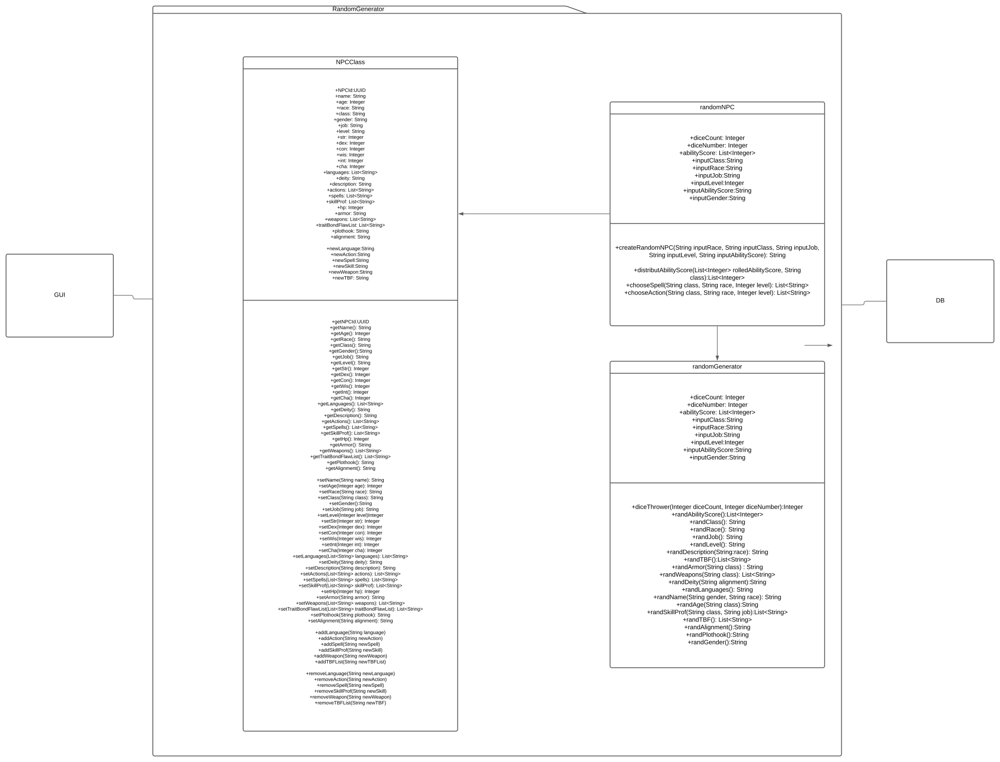
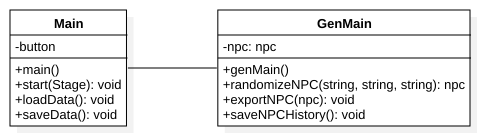

= Pflichtenheft
:project_name: Projektname
== __{project_name}__
:toc:
:toc-title: Inhaltsverzeichnis

== 1. Version

[options="header"]
[cols="1, 1, 1, 1, 4"]
|===
|Version | Status      | Bearbeitungsdatum   | Autoren(en) |  Vermerk
|0.1     |Abgeschlossen| 05.03.2024          | Lucas           | "intiallisierung" der Datei
|0.2     |Abgeschlossen| 12.03.2024          | Luca            | Erste Anwendungsfälle und Füllung einiger leerer Punkte
|===

== 2. Zusammenfassung
In diesem Dokument werden die wesentlichen Hauptmerkmale, Funktionen und Anforderungen des Systems niedergeschrieben.
Insbesondere wird der konkrete Auftrag noch einmal erfasst, und die Nutzung des Produktes, sowie ihre Nutzer identifiziert. 
Der Auftrag wird in essentielle und für die Funktionalität, nicht essentielle Bestandteile aufgeteilt.
In diesem Dokument sind verschiedene Diagramme enthalten, welche Aufbau, Ablauf und Funktionalitäten des Sytsems abbilden.
Neben Diagrammen wurde auch ein visueller Erstentwurf der Benutzeroberfläche erstellt.

== 3. Aufgabenstellung und Zielsetzung
Ein Programm das es ermöglicht schnell und einfach Non-Player-Charakters, kurz NPCs, für das Pen und Paper Spiel Dungeons and Dragons zu generieren, speichern, exportieren und anzupassen. Bei der Generation können dabei verschieden Werte händisch festgelegt werden. Diese sind Rasse, Klasse, Geschlecht, Level und die Art wie die Ability Scores berechnet werden. Wenn hierbei keine Auswahl getroffen wird, werden diese Punkte, wie der Rest des NPCs Zufalls generiert. bei der Generation wird der der erstellte Datensatz in einer History gespeichert, um wenn nötig später erneut aufzurufen. Die erstellten NPCs sollen in der Lage sein bearbeitet zu werden, intern abzuspeichern als auch zu exportieren.

== 4. Produktnutzung
Nutzung des Programmes durch den DM vor oder während einer Dungeon and Dragons Sitzung.  

== 5. Randbedingungen

=== a) Hardware-Vorgaben
Folgende Geräte/Hardware wird zur Nutzen der Software benötigt.

* Computer
* Eingabegeräte(Tastatur,Maus)

=== b) Software-Vorgaben
Windows 11 und 10 nutzbar
Java 21 LTS

=== c) Vorgaben zum Betrieb der Software
Datenbank soll immer persistent gespeichert sein/werden, es soll eine History für die letzten 10 erstellten Charaktere geben.
Datenbank sollen erweiter- bzw. wartbar sein.

== 6. Systemgrenze und Top-Level-Architektur

== 7. Anwendungsfälle
=== a) Akteure
// See http://asciidoctor.org/docs/user-manual/#tables
[options="header"]
[cols="1,4"]
|===
|Name |Beschreibung
|DnDer | Nutzt das System zum Erstellen von NPCs
|===

=== b) Anwedungsfalldiagramm
Sequenzdiagramm NPC Generator
image:models/Sequence_randomNPC.svg[sequencDiagramm]

=== c) Anwendungsfälle

[[UC0010]]
|===
|ID                         |**<<UC0010>>**
|Name                       |Auf Zufallsgenerator zugreifen
|Description                |Der Benutzer soll in der Lage sein auf den Generator zugreifen zu können
|Actors                     |Benutzer
|Trigger                    |Benutzer wählt in der Navigationsleiste den NPC generator aus
|Precondition(s)           a|
- Programm ist geöffnet

- der Benutzer kann lesen

|Essential Steps           a|

1. Der Benutzer drückt einen Knopf
|Extensions |-
|Functional Requirements | 
|===

[[UC0011]]
|===
|ID                         |**<<UC0011>>**
|Name                       |Den Zufallsgenerator verwenden 
|Description                |Der Benutzer soll in der Lage sein den Generator verwenden zu können  
|Actors                     |Benutzer
|Trigger                    |Benutzer wählt den Knopf aus um einen NPC generieren zu lassen
|Precondition(s)           a|
- Der Zufallsgenerator ist ausgewählt und geöffnet

- der Benutzer betätigt den Knopf zum generieren ohne eine Voreinstellung getroffen zu haben

|Essential Steps           a|

1. Der Benutzer wählt den Zufallsgenerator aus
2. Der Benutzer betätigt den Knopf zum generieren ohne eine Vorauswahl getroffen zu haben
|Extensions |-
|Functional Requirements | 
|===

[[UC0012]]
|===
|ID                         |**<<UC0012>>**
|Name                       |Den Zufallsgenerator mit einer Voreinstellung für die Rasse verwenden
|Description                |Der Benutzer soll in der Lage sein den Generator verwenden zu können wenn eine bestimmte Rasse ausgewählt ist  
|Actors                     |Benutzer
|Trigger                    |Benutzer wählt den Knopf aus um einen NPC generieren zu lassen
|Precondition(s)           a|
- Der Zufallsgenerator ist ausgewählt und geöffnet

- Der Benutzer wählt im Feld Rasse eine aus

- der Benutzer betätigt den Knopf zum generieren
|Essential Steps           a|

1. Der Benutzer wählt den Zufallsgenerator aus
2. Der Benutzer wählt eine Rasse aus
3. Der Benutzer betätigt den Knopf zum generieren 
|Extensions |-
|Functional Requirements | <<F0010>>
|===

[[UC0013]]
|===
|ID                         |**<<UC0013>>**
|Name                       |Den Zufallsgenerator mit einer Voreinstellung für die Klasse verwenden
|Description                |Der Benutzer soll in der Lage sein den Generator verwenden zu können wenn eine bestimmte Klasse ausgewählt ist  
|Actors                     |Benutzer
|Trigger                    |Benutzer wählt den Knopf aus um einen NPC generieren zu lassen
|Precondition(s)           a|
- Der Zufallsgenerator ist ausgewählt und geöffnet

- Der Benutzer wählt im Feld Klasse eine aus

- der Benutzer betätigt den Knopf zum generieren
|Essential Steps           a|

1. Der Benutzer wählt den Zufallsgenerator aus
2. Der Benutzer wählt eine Klasse aus
3. Der Benutzer betätigt den Knopf zum generieren 
|Extensions |-
|Functional Requirements | <<F0010>>
|===

[[UC0014]]
|===
|ID                         |**<<UC0014>>**
|Name                       |Den Zufallsgenerator mit einer Voreinstellung für das Geschlecht verwenden
|Description                |Der Benutzer soll in der Lage sein den Generator verwenden zu können wenn ein bestimmtes Geschlecht ausgewählt ist  
|Actors                     |Benutzer
|Trigger                    |Benutzer wählt den Knopf aus um einen NPC generieren zu lassen
|Precondition(s)           a|
- Der Zufallsgenerator ist ausgewählt und geöffnet

- Der Benutzer wählt im Feld Geschlecht eins aus

- der Benutzer betätigt den Knopf zum generieren
|Essential Steps           a|

1. Der Benutzer wählt den Zufallsgenerator aus
2. Der Benutzer wählt ein Geschlecht aus
3. Der Benutzer betätigt den Knopf zum generieren 
|Extensions |-
|Functional Requirements | <<F0010>>
|===

[[UC0015]]
|===
|ID                         |**<<UC0015>>**
|Name                       |Den Zufallsgenerator mit einer Voreinstellung für das Level verwenden
|Description                |Der Benutzer soll in der Lage sein den Generator verwenden zu können wenn ein bestimmtes Level ausgewählt ist  
|Actors                     |Benutzer
|Trigger                    |Benutzer wählt den Knopf aus um einen NPC generieren zu lassen
|Precondition(s)           a|
- Der Zufallsgenerator ist ausgewählt und geöffnet

- Der Benutzer wählt im Feld Level eins aus

- der Benutzer betätigt den Knopf zum generieren
|Essential Steps           a|

1. Der Benutzer wählt den Zufallsgenerator aus
2. Der Benutzer wählt ein Level aus
3. Der Benutzer betätigt den Knopf zum generieren 
|Extensions |-
|Functional Requirements | <<F0010>>
|===

[[UC0016]]
|===
|ID                         |**<<UC0016>>**
|Name                       |Den Zufallsgenerator mit einer Voreinstellung für die Generationsmethode der AbilityScores verwenden
|Description                |Der Benutzer soll in der Lage sein den Generator verwenden zu können wenn eine bestimmte generationsmethode ausgewählt ist  
|Actors                     |Benutzer
|Trigger                    |Benutzer wählt den Knopf aus um einen NPC generieren zu lassen
|Precondition(s)           a|
- Der Zufallsgenerator ist ausgewählt und geöffnet

- Der Benutzer wählt im Feld Generationsmethode eine aus

- der Benutzer betätigt den Knopf zum generieren
|Essential Steps           a|

1. Der Benutzer wählt den Zufallsgenerator aus
2. Der Benutzer wählt eine Generationsmethode aus
3. Der Benutzer betätigt den Knopf zum generieren 
|Extensions |-
|Functional Requirements | <<F0010>>
|===

[[UC0017]]
|===
|ID                         |**<<UC0017>>**
|Name                       |Den erstellten NPC speichern
|Description                |Der Benutzer soll in der Lage sein den erstellten NPC manuell zu speichern
|Actors                     |Benutzer
|Trigger                    |Benutzer wählt den Knopf aus um den NPC zu speichern
|Precondition(s)           a|

- Der Zufallsgenerator ist ausgewählt und geöffnet

- Ein NPC wurde erstellt oder generiert
 
|Essential Steps           a|

1. Der Benutzer wählt den Zufallsgenerator aus
2. Der Benutzer generiert einen NPC
3. Der Benutzer wählt die Option aus für den erstellten NPC weitere Optionen anzeigen zu lassen
4. Weitere Optionen werden angezeigt
5. Der Benutzer betätigt den Knopf zum speichern des NPCs
|Extensions |-
|Functional Requirements | <<F0014>>
|===

[[UC0018]]
|===
|ID                         |**<<UC0018>>**
|Name                       |Den erstellten NPC exportieren 
|Description                |Der Benutzer soll in der Lage sein den erstellten NPC manuell zu exportieren
|Actors                     |Benutzer
|Trigger                    |Benutzer wählt den Knopf aus um den NPC zu exportiern
|Precondition(s)           a|

- Der Zufallsgenerator ist ausgewählt und geöffnet

- Ein NPC wurde erstellt oder generiert
 
|Essential Steps           a|

1. Der Benutzer wählt den Zufallsgenerator aus
2. Der Benutzer generiert einen NPC
3. Der Benutzer wählt die Option aus für den erstellten NPC weitere Optionen anzeigen zu lassen
4. Weitere Optionen werden angezeigt
5. Der Benutzer betätigt den Knopf zum exportieren des NPCs
6. Es werden die Möglichkeiten zum exportieren angezeigt
|Extensions |-
|Functional Requirements | 
|===

[[UC0019]]
|===
|ID                         |**<<UC0019>>**
|Name                       |Den erstellten NPC löschen
|Description                |Der Benutzer soll in der Lage sein den erstellten NPC manuell zu löschen
|Actors                     |Benutzer
|Trigger                    |Benutzer wählt den Knopf aus um den NPC zu löschen
|Precondition(s)           a|

- Der Zufallsgenerator ist ausgewählt und geöffnet

- Ein NPC wurde erstellt oder generiert
 
|Essential Steps           a|

1. Der Benutzer wählt den Zufallsgenerator aus
2. Der Benutzer generiert einen NPC
3. Der Benutzer wählt die Option aus für den erstellten NPC weitere Optionen anzeigen zu lassen
4. Weitere Optionen werden angezeigt
5. Der Benutzer betätigt den Knopf zum löschen des NPCs
6. Der ausgewählte NPC wird aus der Ansicht, Historie und Datenbank gelöscht
|Extensions |-
|Functional Requirements | <<F0012>>
|===

== 8. Funktionale Anforderungen
=== a) Muss-Kriterien
[options="header", cols="2h, 3, 12"]
|===
|ID
|Name
|Beschreibung

|[[F0010]]<<F0010>>
|Auswahlmöglichkeiten für die Zufallsgeneration
a|
Das System ist in der Lage für eine spezifische Eingabe bei der Generation Ergebnisse zu liefern welche die vorher festgelegten Parameter beinhaltet. Die Auswahlmöglichkeiten sind:
- Rasse
- Klasse
- Geschlecht
- Level
- Generationsmehtode für die Ability Scores

|[[F0011]]<<F0011>>
|Exportieren
a|
Das System ist in der Lage den erstellten NPC in verschiedenen Formaten zu exportieren. Die Formate sind:
- PDF
- JPEG
- PNG
- .json Roll20 Format

|[[F0012]]<<F0012>>
|Löschen
a|
Das System ist in der Lage den erstellten NPC zu löschen.

|[[F0013]]<<F0013>>
|Bearbeiten generierter NPCs
a|
Das System soll in der Lage sein, die Funktion anzubieten, alle erstellten Parameter nach dem generieren oder erstellen manuell bearbeiten zu können. 

|[[F0014]]<<F0014>>
|Speichern
a|
Das System ist in der Lage erstellte NPCs intern in einer Datenbank speichern zu können.

|[[F0015]]<<F0015>>
|NPC Builder
a|
Das System ist in der Lage ein Template anzubieten, welches ermöglicht schnell manuell einen NPC zu erstellen

|===

=== b) Kann-Kriterien

[options="header", cols="2h, 3, 12"]
|===
|ID
|Name
|Beschreibung

|[[K0010]]<<K0010>>
|Monster Builder
a|
Das System ist in der Lage ein Template anzubieten, welches ermöglicht schnell manuell ein Monster zu erstellen

|[[K0011]]<<K0011>>
|NPC Verwaltungssystem
a|
Das System ist in der Lage ein NPCs zu speichern und zu verwalten.

|[[K0012]]<<K0012>>
|Freier Zufallsgenerator
a|
Das System soll in der Lage sein ein Template anzubieten, welches ermöglicht eigene Tabellen zu erstellen aus dem das System anschließend zufällige Datensätze auswählt. 

|[[K0013]]<<K0013>>
|NPC Inventare
a|
Das System soll in der Lage sein jedem erstellten NPC ein Inventar hinzuzufügen, welches sowohl manuell als auch zufällig gefüllt werden kann.

|[[K0014]]<<K0014>>
|NPC Sätze
a|
Das System soll in der Lage sein anhand der Klasse, Rasse und Persönlichkeit eines NPCs passende Sätze zu generieren.    

|===

== 9. Nicht-Funktionale Anforderungen

=== a. Qualitätsziele

Die folgende Tabelle zeigt, welche Qualitätsanforderungen in welchem Umfang erfüllt werden müssen.

|===
|Qualtitätsanforderung    | 1 | 2 | 3 | 4 | 5
|Benutzbarkeit            |   |   |   | x |
|Effizienz                |   |   | x |   |
|Korrektheit              |   |   |   | x |
|Robustheit               |   |   |   | x |
|===

=== b. Konkrete Nicht-Funktionale Anforderungen
(Erfüllung mindestens theoretisch)

[options="header", cols="2h, 3, 12"]
|===
|ID
|Name
|Beschreibung

|[[NF0010]]<<NF0010>>
|Benutzbarkeit
a|
Das System soll einfach zu handhaben sein und eine gute Verständlichkeit bieten.

|[[NF0020]]<<NF0020>>
|Effizienz
a|
Das System soll eine niedrige Reaktionszeit vorweisen um flüssiges und schnelles Arbeiten zu ermöglichen.

|[[NF0030]]<<NF0030>>
|Korrektheit
a|
Es sollen innerhalb des Systems Daten richtig übertragen und Befehle ohne fehler ausgeführt werden.

|[[NF0040]]<<NF0040>>
|Robustheit
a|
Das System muss eine Betriebszeit von mindestens 99,5 % erreichen.

|===

== 10. GUI Prototyp

== 11. Datenmodell

=== a) Klassendiagramm
==== Komponente Datenbank:
(DBMS und SQL-DB's noch sehr Vage, da noch für keinen Datenbanktyp bzw. Library entschieden, aktuelle Einträge ergebniss von schnellem Drüberschauen von JPA und H2)
image:models/DBPackageReady.svg[DBPackage]

==== Komponente Random Generator

==== Komponente Main+GenMain

=== b) Klassen und Enumerationen

[options="header"]
|===
|Klasse/Enumeration |Beschreibung 
|NPCClass             | Klasse die den NPC darstellt
|RandomNPC              | Die Klasse dient dazu die NPC Teile sinnvoll zusammenzusetzen und auszubauen 
|RandomGenerator	| Klasse zur zufällige Erstellung verschiedener Attribute
|History	| WIP
|DBInterface	| WIP
|DBMS		| WIP
|Main		| WIP
|GenMain	| WIP

|===

== 12. Akzeptanztestfälle

== 13. Glossar
