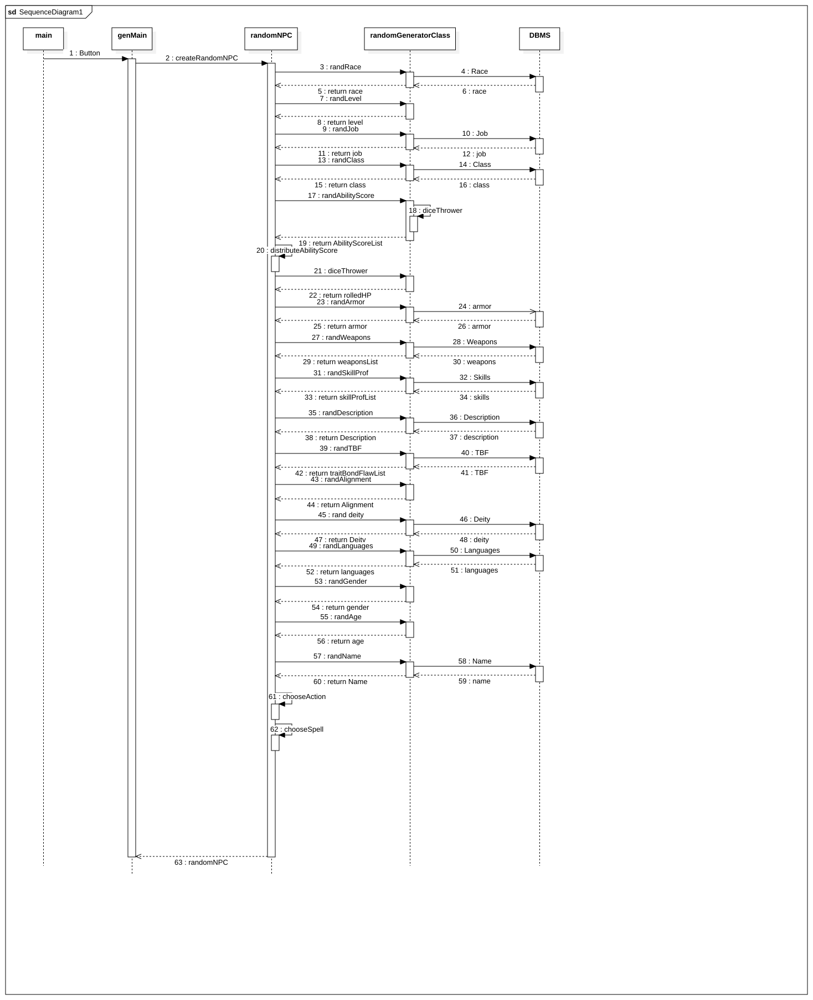
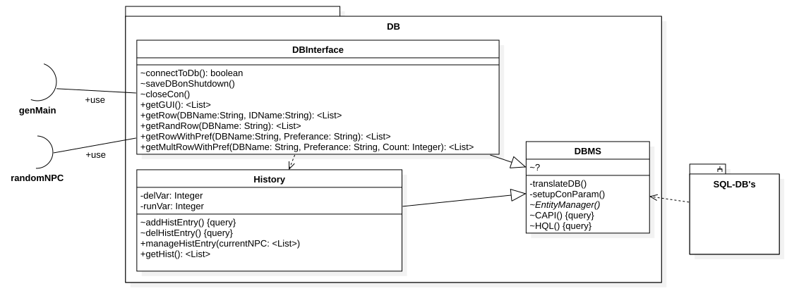

= Pflichtenheft
:project_name: Projektname
== __{project_name}__
:toc:
:toc-title: Inhaltsverzeichnis

== 1. Version

[options="header"]
[cols="1, 1, 1, 1, 4"]
|===
|Version | Status      | Bearbeitungsdatum   | Autoren(en) |  Vermerk
|0.1     |Abgeschlossen| 05.03.2024          | Lucas           | "intiallisierung" der Datei
|===

== 2. Zusammenfassung
In diesem Dokument werden die wesentlichen Hauptmerkmale, Funktionen und Anforderungen des Systems niedergeschrieben.
Insbesondere wird der konkrete Auftrag noch einmal erfasst, und die Nutzung des Produktes, sowie ihre Nutzer identifiziert. 
Der Auftrag wird in essentielle und für die Funktionalität, nicht essentielle Bestandteile aufgeteilt.
In diesem Dokument sind verschiedene Diagramme enthalten, welche Aufbau, Ablauf und Funktionalitäten des Sytsems abbilden.
Neben Diagrammen wurde auch ein visueller Erstentwurf der Benutzeroberfläche erstellt.

== 3. Aufgabenstellung und Zielsetzung
Ein Programm das es ermöglicht schnell und einfach Non-Player-Charakters, kurz NPCs, für das Pen und Paper Spiel Dungeons and Dragons zu generieren, speichern, exportieren und anzupassen. Bei der Generation können dabei verschieden Werte händisch festgelegt werden. Diese sind Rasse, Klasse, Geschlecht, Level und die Art wie die Ability Scores berechnet werden. Wenn hierbei keine Auswahl getroffen wird, werden diese Punkte, wie der Rest des NPCs Zufalls generiert. bei der Generation wird der der erstellte Datensatz in einer History gespeichert, um wenn nötig später erneut aufzurufen. Die erstellten NPCs sollen in der Lage sein bearbeitet zu werden, intern abzuspeichern als auch zu exportieren.

== 4. Produktnutzung
Nutzung des Programmes durch den DM vor oder während einer Dungeon and Dragons Sitzung.  

== 5. Randbedingungen

=== a) Hardware-Vorgaben
Folgende Geräte/Hardware wird zur Nutzen der Software benötigt.

* Computer
* Eingabegeräte(Tastatur,Maus)

=== b) Software-Vorgaben
Windows 11 und 10 nutzbar
Java 21 LTS

=== c) Vorgaben zum Betrieb der Software
Datenbank soll immer persistent gespeichert sein/werden, es soll eine History für die letzten 10 erstellten Charaktere geben.
Datenbank sollen erweiter- bzw. wartbar sein.

== 6. Systemgrenze und Top-Level-Architektur

== 7. Anwendungsfälle
=== a) Akteure
=== b) Anwedungsfalldiagramm
Sequenzdiagramm NPC Generator

=== c) Anwedungsfälle

== 8. Funktionale Anforderungen
=== a) Muss-Kriterien

=== b) Kann-Kriterien

== 9. Nicht-Funktionale Anforderungen

== 10. GUI Prototyp

== 11. Datenmodell

=== a) Klassendiagramm
==== Komponente Datenbank:
(DBMS und SQL-DB's noch sehr Vage, da noch für keinen Datenbanktyp bzw. Library entschieden, aktuelle Einträge ergebniss von schnellem Drüberschauen von JPA und H2)

==== Komponente Random Generator
image:models/RandomGenerator.svg[RandomGenerator]

=== b) Klassen und Enumerationen

== 12. Akzeptanztestfälle

== 13. Glossar
