= Entwicklerdokumentation
:project_name: Projektname
== __{project_name}__
:toc:
:toc-title: Inhaltsverzeichnis

== 1. Version

[options="header"]
[cols="1, 3, 3, 3"]
|===
|Version | Bearbeitungsdatum  | Autor | Beschreibung 
|0.1	| 10.11.2022 | Lucas | Bearbeitung Punke 2.2 bis 5.1
|0.2  | 16.11.2022 | Lennard, Luca und Marie |   teilweise erfüllter Meilenstein 
|0.3  | 18.01.2023 | Lennard, Marie, Michelle und Luca | Aktualisierungen
|1.0  | 22.01.2023 | Luca, Chyntia und Lucas | Aktualisierungen 

|===

== 2. Einführung und Ziele
=== 2.1 Aufgabenstellung
Mit der Software des Uhrenladens arbeiten drei Personengruppen, welche unterschiedliche Anforderungen haben. Verkäufer greifen auf den Katalog (Catalog) zu, welcher alle verkäuflichen Waren (Item) anzeigt, diese werden in Verkaufsgegenstände (Object), Gutscheine (Coupon) und Reparaturen (Repair) unterteilt. Nach Verkauf muss der Lagerbestand angepasst werden, ausgenommen davon sind Reparaturen und Gutscheine. Verkäufer sollten in der Lage sein Waren in den Warenkorb zu legen und zu entfernen. Dabei spielt die Anzahl der Waren nur eine Rolle, wenn sie über den Lagerbestand hinaus geht. Auch soll der Endpreis im Warenkorb angezeigt werden, ebenso wie die Möglichkeit einen Gutschein einzulösen. Uhrmacher hingegen haben Zugriff auf das Lager und eine Auftragsliste bzw. ihre zu bearbeitenden Reparaturaufträge. Der Boss hat zusätlich noch Berechtigung Urlaubsanträge, welche von Verkäufer und Uhrmacher gestellt werden, zu bearbeiten und Gegenstände des Lagers zu löschen, hinzuzufügen und neu aufzufüllen. Für die eben genannten Lageroperationen und allgemeine Bestandsänderungen soll es eine Historie für das Lager geben. Außerdem hat er noch die Möglichkeit Verkäufer und Uhrmacher zu kündigen. Nach abgeschlossenem Verkauf werden gekaufte Produkte, Stückzahl und Gesamtpreis, sowie Kundenname gespeichert. Selbes gilt für eine abgeschlossene Reparatur, hier gibt der Uhrmacher aber noch Materialkosten an und archiviert danach. Wichtig für den Verkaufsprozess ist es, dass es für den Verkäufer möglich ist, einen Kunden entweder neu zu registrieren oder den Warenkorb mit dem bereits bestehenden Kunden zu verbinden. Um dies gewährleisten zu können, müssen Kundendaten gespeichert werden.

=== 2.2 Qualitätsziele
Um die Qualität der Anwendung messen zu können müssen folgende Qualitätsziele definiert und erfüllt werden.
(Im folgenden werden die Beschreibungen der Norm https://www.inztitut.de/blog/glossar/iso-25010/[ISO 25010^] genutzt)

Benutzbarkeit::
Die Benutzbarkeit einer Webseite ist deren “Nutzbarkeit”, die im Wesentlichen in Nutzerfreundlichkeit besteht. Dazu gehört ihre Übersichtlichkeit, die von der Seitenstruktur, vom Design und der logischen Anordnung der Inhalte abhängt.

Effizienz::
Dieses Merkmal stellt die Leistung im Verhältnis zur Menge der unter angegebenen Bedingungen verwendeten Ressourcen dar.

Korrektheit::
Diese Eigenschaft stellt den Grad dar, in dem ein Produkt oder System Funktionen bereitstellt, die die angegebenen und implizierten Anforderungen erfüllen, wenn es unter bestimmten Bedingungen verwendet wird.

Robustheit::
Grad, in dem ein System, Produkt oder eine Komponente bestimmte Funktionen unter bestimmten Bedingungen für einen bestimmten Zeitraum ausführt.

Sicherheit::
Grad, in dem ein Produkt oder System Informationen und Daten schützt, sodass Personen oder andere Produkte oder Systeme den Grad des Datenzugriffs haben, der ihren Arten und Berechtigungsstufen entspricht.

Die folgende Tabelle zeigt wie umfangreich die einzelnen Qualitätsmerkmale ausgeführt werden sollen und welche Priorität ihre Umsetzung hat. Die Stufe 5 ist dabei die höchste Stufe, während die Stufe 1 die niedrigste Prioriät bzw. den niedrigsten Umfang wiederspiegelt.

[options="header", cols="3h, ^1, ^1, ^1, ^1, ^1"]
|===
|Qualtitätsanforderung    | 1 | 2 | 3 | 4 | 5
|Benutzbarkeit            |   |   | x |   |
|Effizienz                |   |   |   | x |
|Korrektheit              |   |   |   | x |
|Robustheit               |   |   |   | x |
|Sicherheit               |   | x |   |   |
|===

== 3. Randbedingungen
=== 3.1 Hardware-Vorgaben
Folgende Geräte/Hardware wird zur Nutzen der Software benötigt.

* Server
* Computer
* Eingabegeräte(Tastatur,Maus)

=== 3.2 Software-Vorgaben
Die folgende Software wird benötigt um das Programm starten und nutzen zu können.

Die folgende(oder neuere) Version von Java wird benötigt um das Programm starten und laufen zu lassen:

* Java 17

Die folgenden(oder neuere) Browserversionen werden benötigt um das Programm nutzen zu können:

* Internet Explorer / Edge 11.0
* Firefox 106.0
* Google Chrome 107.0
* Opera 92.0

=== 3.3 Vorgaben zum Betrieb der Software
Die Software wird als Firmen-interne Software genutzt um Vorgänge zu vereinfachen, digitalisieren und zu zentralisieren. In der Firma werden Uhren verschiedenster Kategorien verkauft und Repariert. Die Software soll auf einem Server laufen und für die Mitarbeiter zu jeder Zeit über den Browser erreichbar sein.

Die Nutzer der Software werden die Mitarbeiter der Firma sein, diese kann man in 3 Kategorien einteilen: Verkäufer, Uhrenmacher und den Boss. Zu beachten ist das keine dieser Gruppen unbedingt einen technischen Hintergrund hat.

Des Weiteren soll die Software so wartungsfrei wie möglich sein. Sie soll 24/7 über einen Server laufen und alle Informationen sollen dauerhaft in einer Datenbank gespeichert werden und in der Software "auf klick", also ohne weiteres technisches Wissen einfach abrufbar sein. 

== 4. Kontextabgrenzung
=== 4.1 Kontextdiagramm
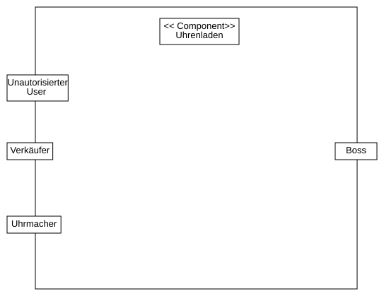

== 5. Lösungsstrategie
=== 5.1 Erfüllung der Qualitätsziele

[options="header"]
[cols="1,4"]
|===
|Name |Beschreibung 
|Benutzbarkeit a|
* *optimale Erkennbarkeit:* Die Software soll in einer Art und Weise gestaltet sein das Knöpfe und andere Schaltflächen gut erkennbar und eindeutig bennant sind, das keine,für diverse Gruppen, nachteiligen Farbkombinationen benutzt werden und das die Seiten übersichtlich gestaltet sind.
* *einfacher Zugang:* Die Software soll in einer Art und Weise gestaltet sein das alle Nutzer schnell und einfach an die für sie wichtigen Informationen kommen ohne das sie dabei eine zu hohe Anzahl vermeidbarer Handgrife tätigen müssen.
* *leicht erlernbar:* Die Software soll in einer Art und Weise gestaltet sein das alle Nutzer, auch diese die die Software zum ersten mal nutzen, alle Schaltflächen, Auflistungen und Information ohne viel Überlegung und ohne sie "testen" zu müssen verstehen können. Dies kann mit eindeutigen Namen und einer intuitiven Gestaltung verwirklicht werden.
|Effizienz a|
* *gutes Zeitverhalten:* Die Software soll so konzipiert sein das sie während der Nutzung eine geringe Reaktionszeit besitzt um das Arbeiten mit der Software angenehmer zu machen. Dafür muss die Software die ihr zur Verfügung stehenden Ressourcen effizient nutzen.
* *Ressourcen effizient nutzen:* Die Software soll so konzipert sein das sie während der Laufzeit die ihr zur Verfügung stehenden Ressourcen effizient nutzt. Die kann mit Speichersparender Programmierung erreicht werden.
|Korrektheit a|
* *vollständig hinsichtlich Softwarefunktionen:* Die Software soll alle gesetzten Muss-Kriterien vollständig erfüllen.
* *funktional Korrekt:* Die Software soll intern Daten und Funktionen korrekt und wie vorgesehen ausführen und übertragen und nicht intern neue Fehler einspeisen. Dies kann mit Unit Tests verwirklicht werden.
|Robustheit a|
* *Fehlertoleranz:* Die Software soll vor Fehleingaben schützen. Falsche Eingaben dürfen das System nicht in seiner Funktion stören. Dies kann unter anderem mit der Einschränkung der Eingabe in Textfelder vermöglicht werden, so das nur Informationen eingegeben werden können mit denen das System umgehen kann.
* *Verfügbarkeit:* Das System soll immer erreichbar sein und alle Informationen dauerhaft und sicher gespeichert werden. Die kann man aus einer Kombination aus einem Server mit Datenbank verwirklicht werden.
|Security a|
* *Authentizierbarkeit:* Einige Aktionen und/oder Events sollen zu den auslösenden Personen zurückverfolgbar sein. So kann man z.B.: jedem Verkauf einen Mitarbeiter(hier Verkäufer) und Kunden zuordnen.
* *Datenschutz* Wenn niemand eingelogt ist, also ein Unautorisierter User auf das System zugreift, soll er nur auf die Login-Seite Zugriff besitzen und, ohne weitere Autorisierung, an keine weiteren Informationen kommen können. Dies kann mit Thymeleaf und Spring Security verwirklicht werden(`sec:authorize`).
* *Eindeutig zugeordnete Rechte* Alle User sollen nur die Informationen und Komponenten sehen, und auf diese zugreifen können wenn sie die dafür richtige Autorisierung besitzen. Dies kann mit Thymeleaf und Spring Security verwirklicht werden(`sec:authorize`).
|===

=== 5.2 Softwarearchitektur

==== Top-Level-Architektur 
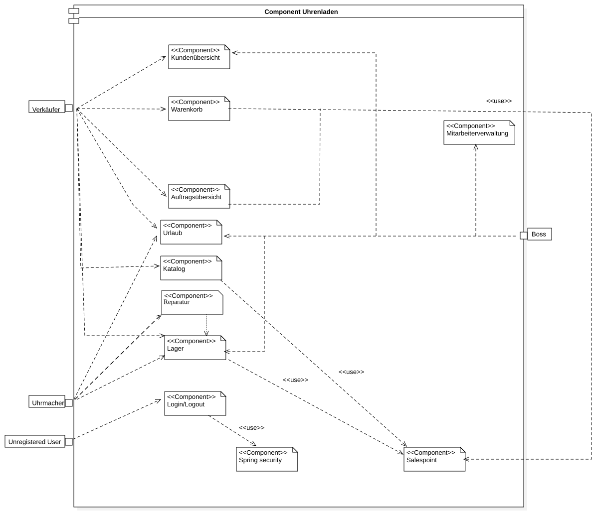

==== Client Server Diagramm
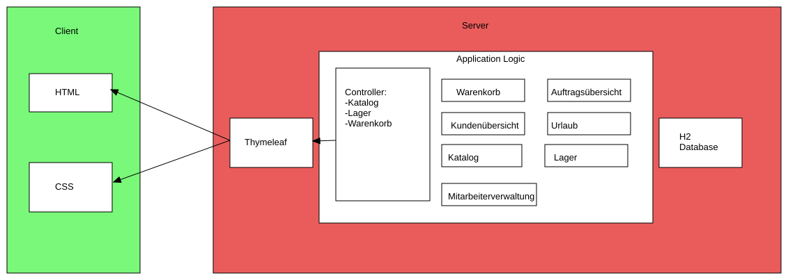

HTML- Vorlagen werden lokal beim Client erstellt mit den dazugehörigen CSS- Stylesheets. Die Daten die in den HTML-Vorlagen angezeigt werden von Thymeleaf geliefert. Thymeleaf erhält die angefragten Daten durch die Controller Klassen. Diese Controller Klassen verwenden Instanzen und Methoden der Model Klassen. Bei Voreinstellung werden die Daten in einer H2 Datenbank gespeichert.  

=== 5.3 Entwurfsentscheidungen

==== 5.3.1 Verwendete Muster

  - Spring MVC

==== 5.3.2 Persistenz

Diese Software verwendet Hibernate annotationsbasiertes Mapping. Als Datenbank wird H2 verwendet. Die dauerhafte Speicherung ist bei Voreinstellung deaktiviert.  
 
==== 5.3.3 Benutzeroberfläche

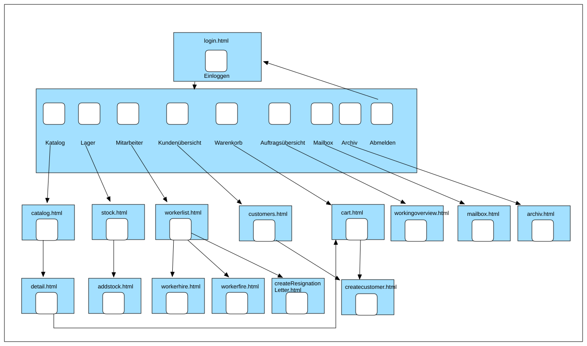

=== 5.4 Verwendung externer Frameworks

[options="header", cols="1,2"]
|===
|Externes Package |Verwendet von (Klasse der eigenen Anwendung)
|salespointframework.catalog a|
* catalog.ClockCatalog
* catalog.CatalogController
* reparatur.Reparaturcatalog
* inventory.InventoryController
|salespointframework.inventory a|
* catalog.CatalogController
* inventory.InventoryController
* order.OrderController
|salespointframework.order a|
* order.OrderController
|salespointframework.payment 
* reparatur.ReparaturController a|
* catalog.CatalogController
* inventory.InventoryController
* archiv.ArchivController
* order.OrderController
|salespointframework.quantity a|
* inventory.InventoryController
* inventory.Movement
* order.OrderController
* catalog.CatalogController
|salespointframework.SalespointSecurityConfiguration a|
* benutzerkonto.BenutzerdataInitializer
|salespointframework.time a| 
* catalog.CatalogController
|salespointframework.useraccount a|
* benutzerkonto.BenutzerDataInitializer
|springframework.boot a|
* Uhrenladen
|springframework.data a|
* worker.WorkerDataInitializer
* reparatur.ReparaturCatalogDataInitializer
* customer.CustomerDataInitializer
* inventory.InventoryInitializer
* inventory.MovementDataInitializer
* catalog.CatalogDataInitializer
* benutzerkonto.BenutzerDataInitializer
* archiv.ArchivReparaturDataInitializer
|springframework.security a|
* inventory.InventoryController
* inventory.MovementController
* order.OrderController
|springframework.ui a|
* catalog.CatalogController
* reparatur.ReparaturController
* worker.WorkerController
* customer.CustomerController
* order.OrderController
* inventory.InventoryController
* inventory.MovementController
* worker.HolidayController
|===

== 6. Bausteinsicht

=== 6.1 Catalog
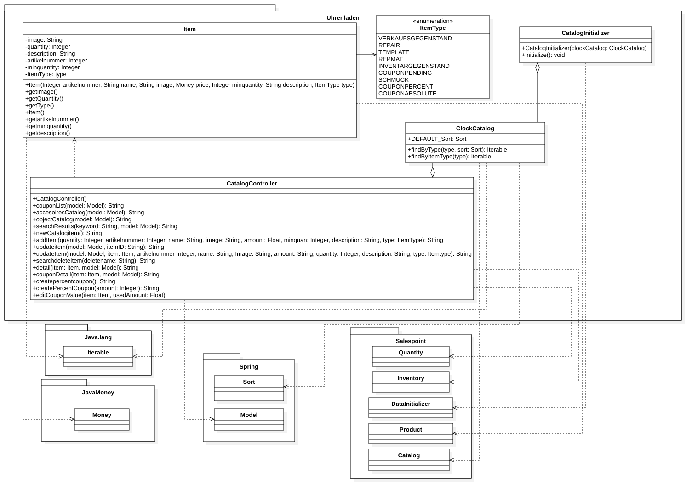
[options="header"]
|=== 
|Klasse/Enumeration |Beschreibung
|Item|Stellt alle verkäuflichen Waren und Dienstleistungen dar
|ItemType|Unterscheidet zwischen Gutschein, Waren und Reparatur
|CatalogController|Erstellt eine Liste sortiert nach ItemType
|ClockCatalog|Sortiert Katalog zum Anfang
|CatalogInitializer|Erstellt einen Katalog mit dummy-data für Testzwecke
|===

=== 6.2 Mitarbeiterverwaltung
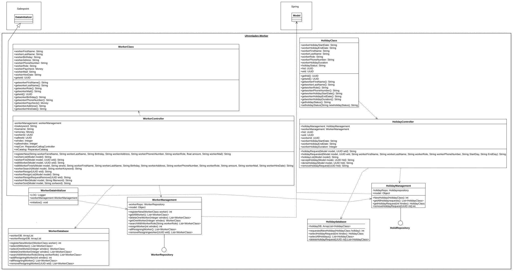
[options="header"]
|=== 
|Klasse/Enumeration |Beschreibung
|WorkerClass| Klasse die die Arbeiter darstellt
|WorkerController|Erstellung, Löschen und Bearbeitung von Mitarbeiterdaten
|WorkerManagement|Verwaltung und Kommunizierung des WorkerRepository mit anderen Klassen
|WorkerRepository|Verwaltung der gespeicherten Daten 
|WorkerDatabase|Speicherung aller Arbeiterdaten
|HolidayClass|Klasse die die Urlaubsanfragen darstellt
|HolidayController|Erstellen, Löschen und Bearbeitung von Urlaubsanfragen
|HolidayManagement| Verwaltung und Kommunizierung des HolidayRepositorys mit anderen Klassen
|HolidayRepository|Verwaltung der gespeicherten Daten
|HolidayDatabase|Speicherung aller Urlaubsanfragen
|WorkerDataInitializer|Erstellt Daten für Testzwecke
|===

=== 6.3 Reparatur
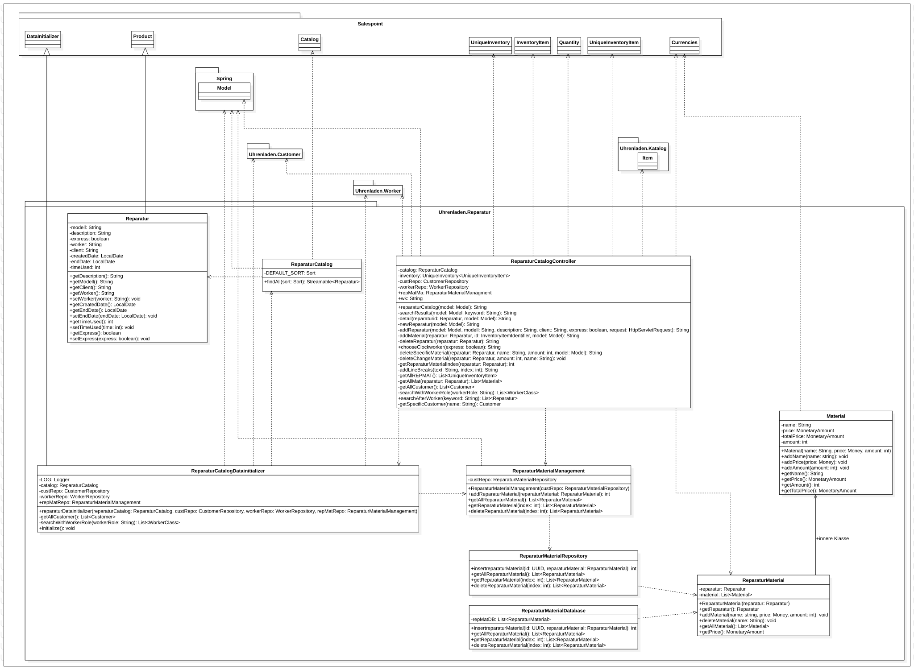
[options="header"]
|=== 
|Klasse/Enumeration |Description
|Reparatur |Benutzerdefinierte Klasse zur Erweiterung des Salespoint-Product, es stellt ein Reparaturauftrag da.
|ReparaturCatalog |Ist eine Erweiterung des Salespoint-Catalog für Reparaturaufträge.
|ReparaturCatalogCaontroller |Kontroliert und Kommuniziert mit der Html Ebene. Kontroliert alles was mit Reparaturaufträgen zu tun hat.
|ReparaturDatainitializer |Erzeugt Datensätze für Testzwecke.
|Material |Klasse, die ein Material für Reparaturen darstellt. Ist innere Klasse von ReparaturMaterial.
|ReparaturMaterial |Klasse, die eine Liste, bzw. alle verwendeten Materialien von einem Reparaturauftrag darstellt.
|ReparaturMaterialDatabase |Speicherung und Verwaltung der ReparaturMaterial Klassen.
|ReparaturMaterialRepository |Speicherung und Verwaltung der ReparaturMaterial Klassen.
|ReparaturMaterialManagement |Verwaltung und Kommunizierung des ReparaturMaterialRepository mit anderen Klassen.
|===

=== 6.4 Inventar
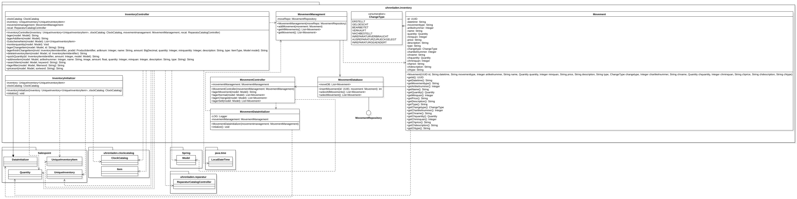
[options="header"]
|=== 
|Klasse/Enumeration |Description
|InventoryController | Verwaltet alle Funktionen die im Inventar arbeiten
|InventoryInitializer |Erstellt bei Anwendungsstart "dummy"-Daten für Testzwecke
|Movement |Klasse die die einzelnen Lagerbewegungen darstellt
|MovementRepository |Verwaltung der gespeicherten Daten
|MovementDatabase |Speicherung aller Lagerbewgungen und ihren Informationen
|MovementManagement |Sorgt für Verwaltung und Kommunikation des Repository mit anderen Klassen
|MovementController | Verwaltet alle funktionen die mit den Lagerbewegungen arbeiten
|===

=== 6.5 Warenkorb
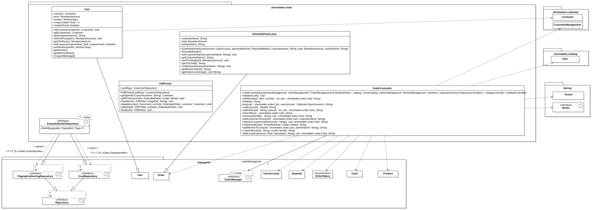
[options="header"]
|=== 
|Class/Enumeration |Description
|OrderController|Ein Spring MVC Controller zur Handhabung des Wagens
|Cart|Eine Erweiterung der Cart-Klasse, um Kunden zum Warenkorb hinzuzufügen
|ExtendedOrder|Eine Erweiterung der Order-Klasse, um Bestellung zu erstellen
|ExtendedOrderRepository|Erstellung Liste um die Bestellungen zu speichern
|PdfPrinter|Bestellungdetails auszudrucken
|===

=== 6.6 Archiv
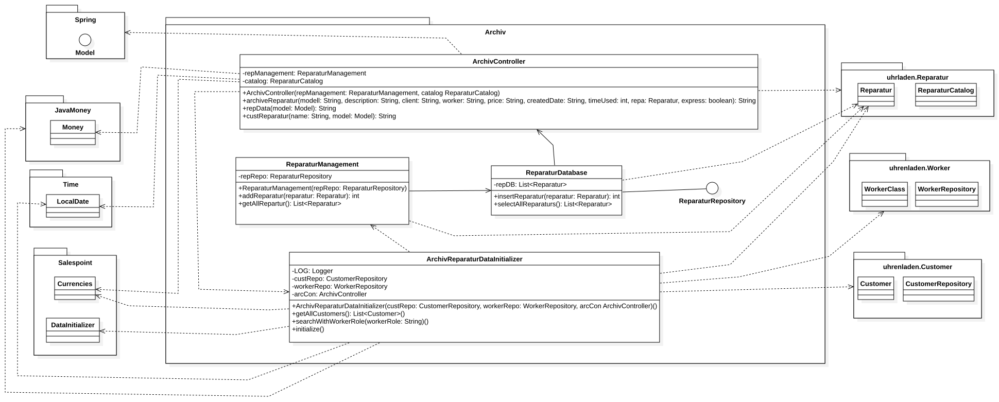
[options="header"]
|=== 
|Class/Enumeration |Description
|ReparaturDatabase|Erstellung Liste um die abgeschlossene Reparaturen zu speichern
|ReparaturManagement|Hinfügen die abgeschlossene Reparaturen der Liste, Darstellung der Liste von abgeschlossenen Reparaturen
|ArchivController|Ein Spring MVC Controller zur Hinfügen der abgeschlossenen Reparaturen und Darstellung der Liste von abgeschlossenen Reparaturen
|ArchivReparaturDataInitializer|Erzeugt abgeschlossene Reparaturen für Testzwecke
|===

=== 6.7 Kundenverwaltung
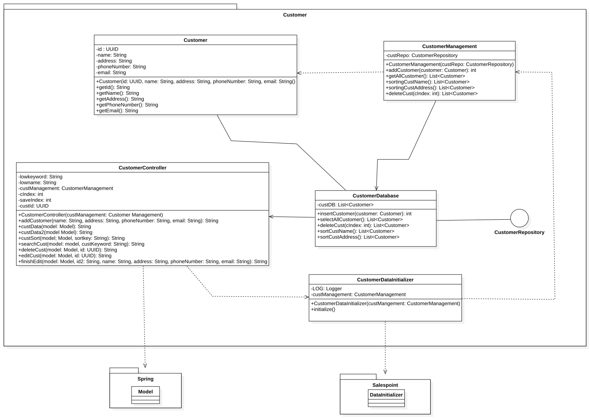
[options="header"]
|=== 
|Class/Enumeration |Description
|Customer|Erstellung von Kundendaten
|CustomerDatabase|Erstellung Liste um die Kundendaten zu speichern
|CustomerManagement|Hinfügen Kundendaten, Darstellung der Liste von Kunden
|CustomerController|Ein Spring MVC Controller zur Hinfügen der Kundendaten und Darstellung der KundenListe
|CustomerDataInitializer|Erzeugt Kundendaten für Testzwecke

|===

=== 6.8 Rückverfolgbarkeit zwischen Analyse- und Entwurfsmodell
_Die folgende Tabelle zeigt die Rückverfolgbarkeit zwischen Entwurfs- und Analysemodell. Falls eine Klasse aus einem externen Framework im Entwurfsmodell eine Klasse des Analysemodells ersetzt,
wird die Art der Verwendung dieser externen Klasse in der Spalte *Art der Verwendung* mithilfe der folgenden Begriffe definiert:_

* Inheritance/Interface-Implementation
* Class Attribute
* Method Parameter

[options="header"]
|===
|Klasse/Enumeration (Analysemodell) |Klasse/Enumeration (Entwurfsmodell) |Art der Verwendung
|...|...|...
|===

== 7. Laufzeitsicht
* Darstellung der Komponenteninteraktion anhand eines Sequenzdiagramms, welches die relevantesten Interaktionen darstellt.

=== 7.1 Katalog
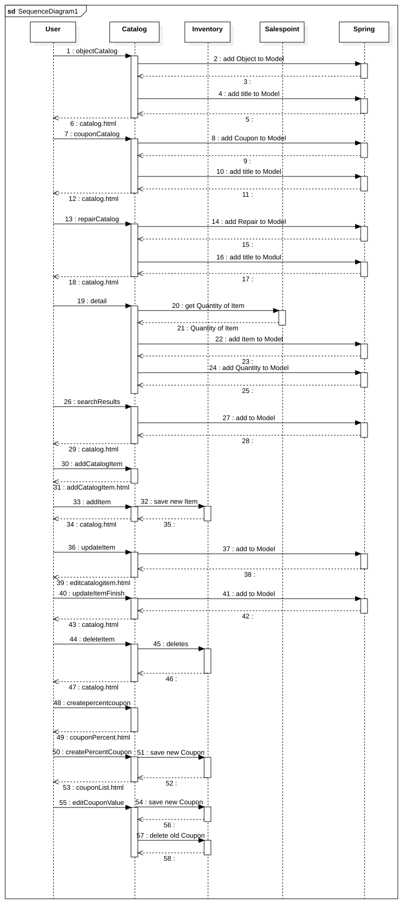

=== 7.2 Mitarbeiterverwaltung
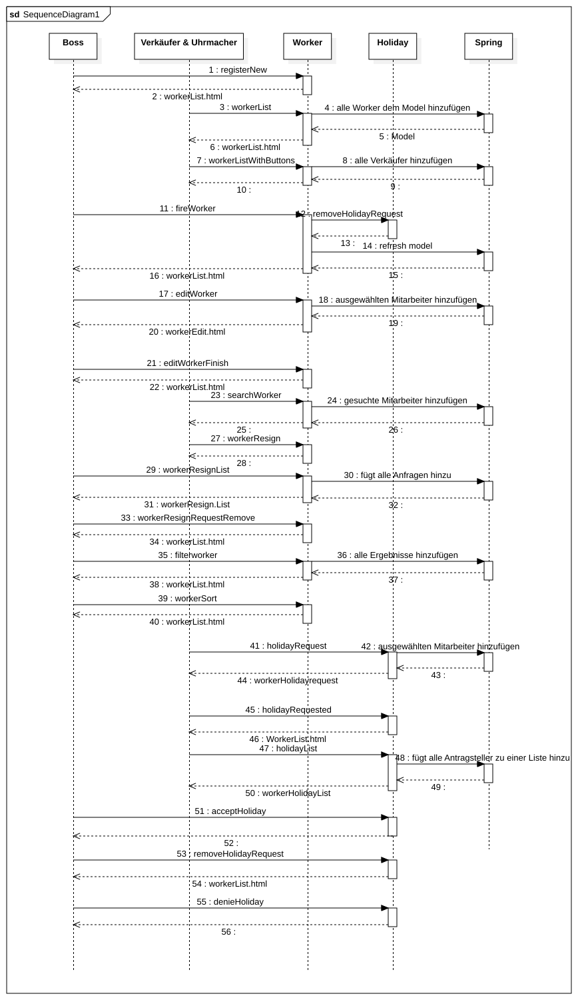

=== 7.3 Reparatur
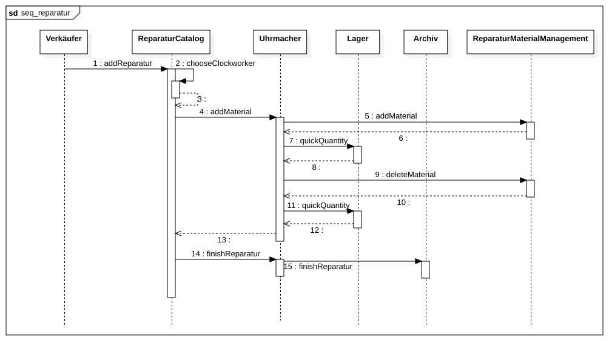

=== 7.4 Inventar
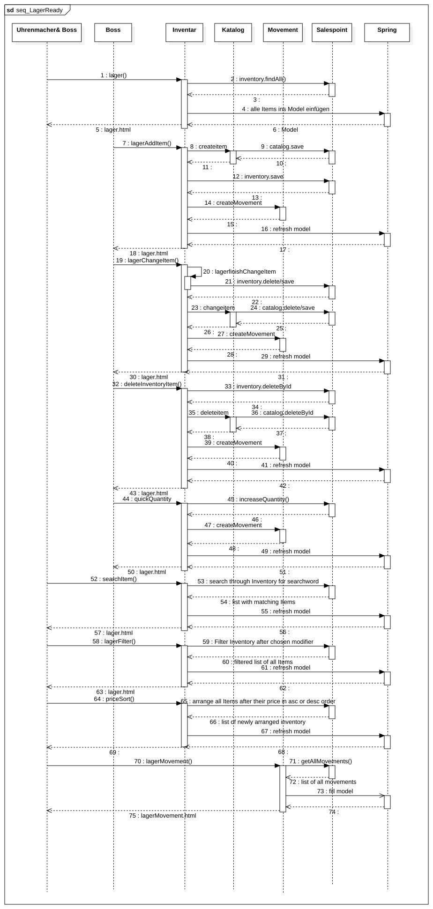

=== 7.5 Warenkorb
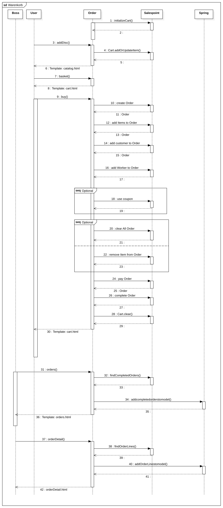

=== 7.6 Archiv
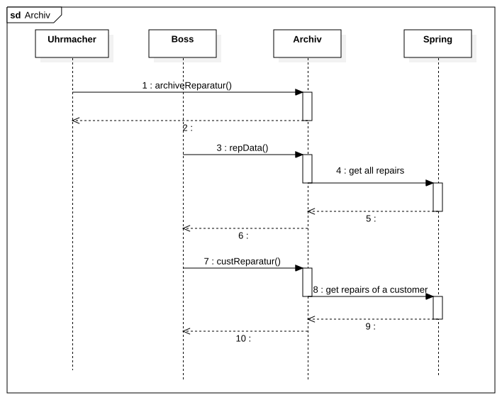

=== 7.7 Kundenverwaltung
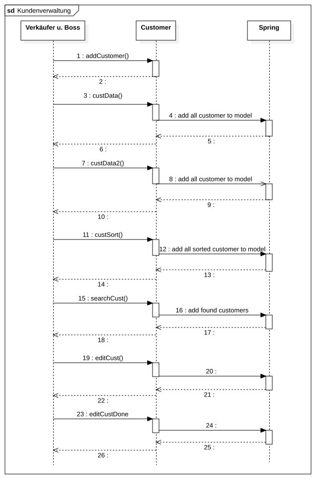

== 8. Technische Schulden
[options="header"]
|===
|Priorität |Beschreibung |Ort|Betreffendes Quality Gate
|Critical|Refactor this method to reduce its Cognitive Complexity from 20 to the 15 allowed|uhrenladen.order.OrderController.java| Maintainability
|Major|Rename this class|uhrenladen.order.Cart.java|Maintainability
|Major|Reduce the number of return of this method 4, down to the maximum allowed 3|uhrenladen.order.OrderController|Maintainability
|Major|refactor this code to not nest more than if/for/while/switch/try statements|uhrenladen.order.OrderController|Maintainability
|Info|Split this 131 characters long line (which is greater than 120 authorized)|uhrenladen.order.Cart.java|Maintainability
|Info|Split this 139 characters long line (which is greater than 120 authorized)|uhrenladen.order.ExtendedOrder.java|Maintainability
|Info|Split this 163 characters long line (which is greater than 120 authorized)|uhrenladen.order.ExtendedOrderRepository.java|Maintainability
|4xInfo|Split this >120 characters long line (which is greater than 120 authorized)|uhrenladen.order.OrderController.java|Maintainability
|===

