= Pflichtenheft
:project_name: Projektname
== __{project_name}__
:toc:
:toc-title: Inhaltsverzeichnis

== 1. Version

[options="header"]
[cols="1, 1, 1, 1, 4"]
|===
|Version | Status      | Bearbeitungsdatum   | Autoren(en) |  Vermerk
|0.1     |Abgeschlossen| 25.10.2022          | Alle           | Ergebniss des ersten internen Meetings.
|0.2     |Abgeschlossen| 26.10.2022          | Alle           | Ergebniss des zweiten internen Meetings.
|0.3     |Abgeschlossen| 31.10.2022          | Alle           | Ergebniss des individuellen arbeitens nach Aufgabeneinteilung.
|0.4     |Abgeschlossen| 01.11.2022          |Chyntia,Michelle| Arbeit an Abschnitt 6.
|0.5     |Abgeschlossen| 02.11.2022          | Alle           | Zusammenführung, Korrekturen, finale Änderungen.
|1.0     |Abgeschlossen| 03.11.2022 bis 07.11.2022| Alle           | Abschließen der Nachbesserungen.
|===

== 2. Zusammenfassung
In diesem Dokument werden die wesentlichen Hauptmerkmale, Funktionen und Anforderungen des Systems niedergeschrieben.
Insbesondere wird der konkrete Auftrag noch einmal erfasst, und die Nutzung des Produktes, sowie ihre Nutzer identifiziert. 
Der Auftrag wird in essentielle und für die Funktionalität, nicht essentielle Bestandteile aufgeteilt.
In diesem Dokument sind verschiedene Diagramme enthalten, welche Aufbau, Ablauf und Funktionalitäten des Sytsems abbilden.
Neben Diagrammen wurde auch ein visueller Erstentwurf der Benutzeroberfläche erstellt.

== 3. Aufgabenstellung und Zielsetzung

Im Verkaufsbereich werden Waren angeboten, z.B. Armband- und Taschenuhren, Wecker, Wanduhren oder Kaminuhren, sowie Gutscheine sowohl als Gesamtbetrag oder auch als Prozentualer Rabatt. Über die Liste der Produkte soll es auch eine Suchfunktion geben. Es soll die Möglichkeit für den Verkäufer geben, ein Detail Fenster für das Produkt zu öffnen. Wenn ein Kunde etwas kaufen möchte, gibt der Verkäufer Kundendaten ein und fügt Produkt(e) zum Warenkorb hinzu. Hier soll es die Möglichkeit geben, Gegenstände wieder zu entfernen, zu Bezahlen und Gutscheine einzulösen. Im Lager sind also verschieden große Mengen der Waren (Verbrauchsmaterial, Zubehör und Uhren) vorrätig, in regelmäßigen Abständen werden Ladenhüter vom Boss aussortiert und als Verlust verbucht. Außerdem kann der Boss alle Gegenstände im Lager nachbestellen, um dies zu vereinfachen, werden Gegenstände, welche nur noch eine kleine Stückzahl haben hervorgehoben, er kann auch neue Produkte zum Lager hinzufügen. Hierfür soll es eine Liste geben, welche die Aktivität des Lagers protokolliert. Neben den Uhren kann man im Laden auch Zubehör (Armbänder, Batterien etc.) und eine kleine Auswahl an Modeschmuck kaufen. Bringt ein Kunde eine Uhr zur Reparatur, werden seine Daten aufgenommen (Name, Mail, Adresse, Nummer). In der Werkstatt bearbeitet der Uhrmacher, welcher eine TO-DO Liste bekommt, alle eingehenden Aufträge nacheinander (Ausnahme: ein Kunde wünscht gegen Aufpreis die Reparatur im 24h-Service à Ende des nächsten Tages). Bei der Verteilung der Aufträge wird auf eine ausgewogene Arbeitsverteilung geachtet. Ist die Reparatur erledigt, gibt er den Materialverbrauch und die benötigte Zeit an und archiviert diesen Auftrag. Daraus berechnet sich der Preis und alles zusammen wird in einer Rechnung für den Kunden zusammengestellt. Auch Radiowecker werden zur Reparatur entgegengenommen und an den Hersteller weitergesendet. Boss kann per Knopfdruck Mitarbeiter kündigen und einstellen. Uhrmacher können auf die Kundenübersicht und Reparatur-Aufträge zugreifen, Verkäufer auf den Produkt Katalog und die Kundenübersicht. Mitarbeiter können ihren Urlaub einreichen und Boss entscheidet ob diese Bewilligt werden. Sobald Urlaub genehmigt ist, werden bestehende Aufträge eingefroren und keine neuen zugeteilt.

== 4. Produktnutzung

Nutzung durch Verkäufer während der Kundengespräche, Vergabe der Aufträge, Einsicht der Aufträge durch Uhrmacher, Lagerbearbeitung durch Boss, Urlaubseinreichung aller Mitarbeiter, Bearbeitung der Urlaubsanträge durch Boss, Personalverwaltung durch Boss, Nachbestellung,

== 5. Interessensgruppen (Stakeholders)

[options="header", cols="2, ^1, 4, 4"] 

|=== 
|Name
|Priorität(1..5) 
|Beschreibung 
|Ziele 

|Uhrenladen 
|5 
|Hauptkunde dieses Projekts. 
a| 
- Mehr Umsatz machen 
- Verkäufe vereinfachen 
- Arbeitsalltag digitalisieren 

|Boss 
|4 
|Administriert Lager und Mitarbeiter 
a| 
- Mitarbeiter verwalten 
- Lager bearbeiten 
- Vereinfachung der Arbeit seiner Mitarbeiter 

|Uhrmacher 
|3 
|Nutzt das Programm als Auftragsübersicht und TO-DO Liste. 
a| 
- Auftragsübersicht haben 
- gleichmäßige Aufgabenverteilung 
- Auf Lagerbestand zugreifen 

|Verkäufer
|3 
|Benutzt das System für Kundegespräche.
a| 
- Auf Katalog zugreifen zu können 
- Aufträge anlegen 

|===

== 6. Systemgrenze und Top-Level-Architektur

=== a. Kontextdiagramm

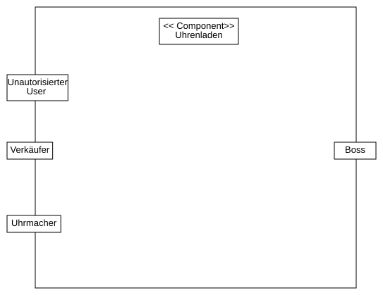

=== b. Top-Level-Architektur

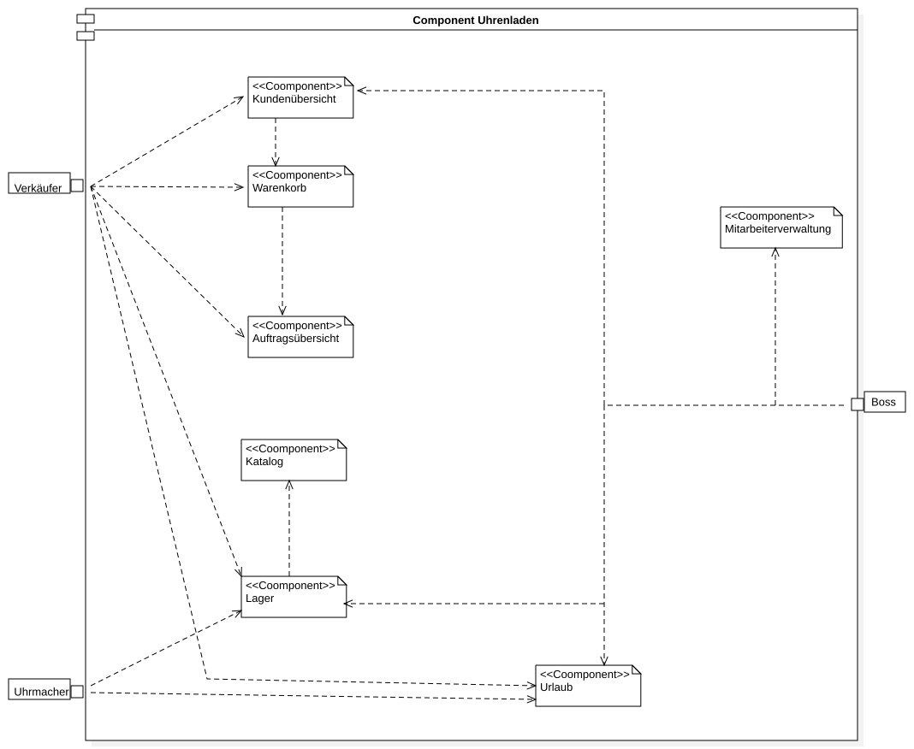

== 7. Anwendungsfälle

=== a. Akteure

// See http://asciidoctor.org/docs/user-manual/#tables
[options="header"]
[cols="1,4"]
|===
|Name |Beschreibung
|Boss |Nutzt das System für die Verwaltung seiner Mitarbeiter, Pflege des Lagers und 
Bearbeitung von Urlaubsanträgen.
|Uhrmacher |Nutzt das System um Reparaturaufträge abzuschließen, den Bestand des Lagers
abzurufen, Urlaub zu beantragen und seine Auftragsliste einzusehen.
|Verkäufer |Nutzt das System für Kundengespräche, welche das Erstellen von Reparaturaufträgen
beinhalted, sowie der Kauf von Produkten und Urlaub zu beantragen
|===

=== b. Überblick Anwendungsfalldiagramm
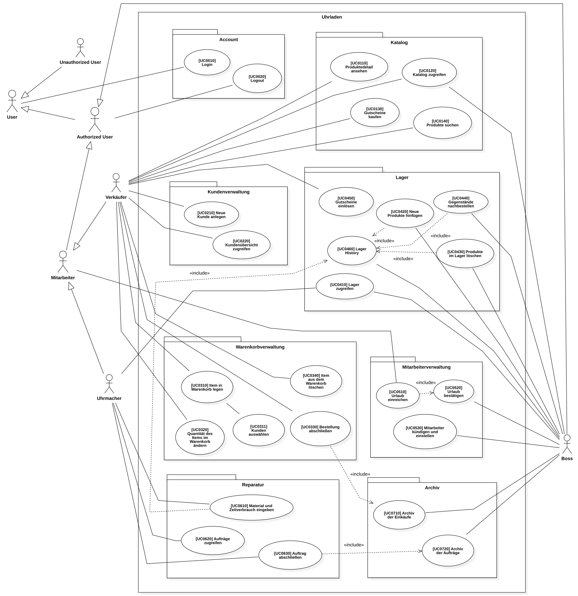

=== c. Anwendungsfallbeschreibungen

[cols="1h,3"]
[[UC0010]]
|===
|ID                         |**<<UC0010>>**
|Name                       |Login
|Description                |Ein Benutzer muss sich beim System anmelden (authentifizieren) können, um auf weitere Funktionen zuzugreifen. 
|Actors                     |User
|Trigger                    |Der Benutzer möchte auf die Funktionalität zugreifen, indem er sich anmeldet
|Precondition(s)           a|Benutzer ist noch nicht authentifiziert
|Essential Steps           a|
1. Der Benutzer wird die Login-Seite als Startbildschirm angezeigt

2. Der Benutzer gibt seine Anmeldeinformationen ein

3. Der Benutzer klickt auf die Schaltfläche „Login“.
|Extensions                 |-
|Functional Requirements    | <<F0010>>
|===

[[UC0020]]
|===
|ID                         |**<<UC0020>>**
|Name                       |Logout
|Description                |Ein Benutzer muss sich beim System abmelden können
|Actors                     |Authorized User
|Trigger                    |Benutzer möchte den Website verlassen
|Precondition(s)           a|Der Benutzer ist authentifiziert
|Essential Steps           a|
1. Der Benutzer klickt in der Navigationsleiste auf „Log out“
2. Der Benutzer ist nicht authentifiziert und erhält den Startbildschirm
|Extensions                 |-
|Functional Requirements    | <<F0011>>
|===

[[UC0110]]
|===
|ID                         |**<<UC0110>>**
|Name                       | Produktdetail ansehen
|Description                | Die Details des Produkts können angezeigt werden, das sind der Name, der Preis, der Bestand, das Bild und die Beschreibung
|Actors                     | Verkäufer
|Trigger                    | Der Verkäufer möchte die Details eines bestimmten Produkts im Katalog sehen
|Precondition(s)           a| Der Benutzer ist authentifiziert und mit dem Konto "Verkäufer" angemeldet
|Essential Steps           a|
1.  Verkäufer wählt „Katalog“ in der Navigationsleiste aus
2.  Sucht nach einem bestimmten Produkt
3.  Druckt auf „details“
4.  Man wird die Produktdetails angezeigt
|Extensions                 |-
|Functional Requirements    | <<F0032>>
|===

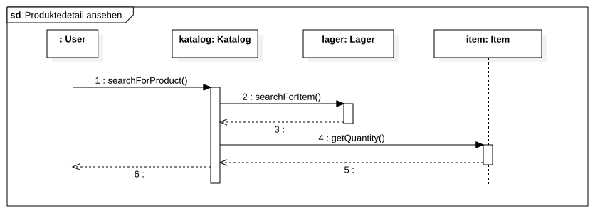

[[UC0120]]
|===
|ID                         |**<<UC0120>>**
|Name                       |Katalog zugreifen
|Description                |Die Verkäufer haben Zugriff auf den Katalog, der alle verkauften Produkte zeigt. Der Katalog muss die Möglichkeit bieten, zwischen verschiedenen Arten von Produkten zu unterscheiden.
|Actors                     |Verkäufer
|Trigger                    |Verkäufer möchten der Katalog sehen
|Precondition(s)           a|User hat die Rolle Verkäufer
|Essential Steps           a|
1. Benutzer wählt Katalog in der Navigationsleiste
2. Alle Produkte werden angezeigt
|Extensions                 |-
|Functional Requirements    | <<F0030>> 
|===

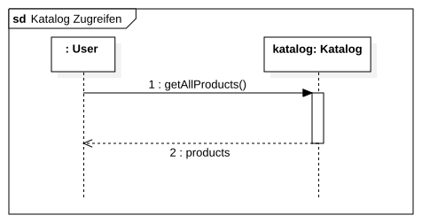

[[UC0130]]
|===
|ID                         |**<<UC0130>>**
|Name                       | Gutscheine erstellen
|Description                | Der Verkäufer kann einen zu verkaufenden Gutscheincode generieren.
|Actors                     | Verkäufer
|Trigger                    | Der Verkäufer möchte einen Gutschein mit einem bestimmten Guthaben für den Kunden generieren, der ihn bestellt.
|Precondition(s)           a| User hat die Rolle Verkäufer
|Essential Steps           a|
1. Benutzer wählt Katalog in der Navigationsleiste
2. Benutzer wählt Gutschein 
3. Gutscheincode wird generiert
4. Benutzer fügt den Betrag hinzu
5. Benutzer klickt auf "Zum Warenkorb hinfügen"
|Extensions                 |-
|Functional Requirements    | <<F0033>>
|===

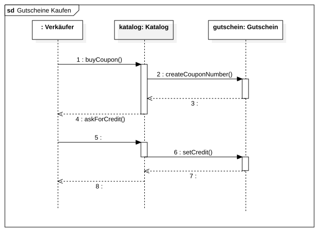

[[UC0140]]
|===
|ID                         |**<<UC0140>>**
|Name                       | Produkt suchen
|Description                | Der Verkäufer kann über die Suchfunktion ein bestimmtes Produkt im Katalog finden
|Actors                     | Verkäufer
|Trigger                    | Der Verkäufer möchte im Katalog nach einem bestimmten Produkt suchen
|Precondition(s)           a| User hat die Rolle Verkäufer
|Essential Steps           a|
1. Verkäufer wählt Katalog in der Navigationsleiste
2. Verkäufer gibt den Namen des gesuchten Produkts in das Suchfeld ein
3. Verkäufer klickt auf "Suchen"
4. Das gesuchte Produkt wird angezeigt
|Extensions                 |-
|Functional Requirements    | <<F0031>>
|===

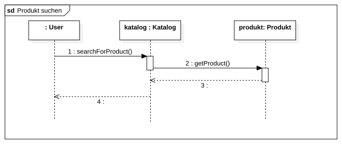

[cols="1h,3"]
[[UC0210]]
|===
|ID                         |**<<UC0210>>**
|Name                       |Neuen Kunden anlegen
|Description                |Verkäufer sollte in der Lage sein, neu Kundendaten einzugeben
|Actors                     |Verkäufer
|Trigger                    |Der Verkäufer möchte die Daten eines Neukunden in die Kundenübersicht aufnehmen
|Precondition(s)           a|Benutzer ist authentifiziert und mit dem Konto "Verkäufer" angemeldet
|Essential Steps           a|
1.  Verkäufer wählt in der Navigationsseite „Kundenübersicht" 
2.  Klickt man auf „Neuer Kunde hinzufügen“
3.  Es öffnet sich ein Fenster, in dem Name, Adresse, Telefonnummer und Email eingegeben werden können
|Extensions                 |-
|Functional Requirements    | <<F0040>>, <<F0041>>
|===

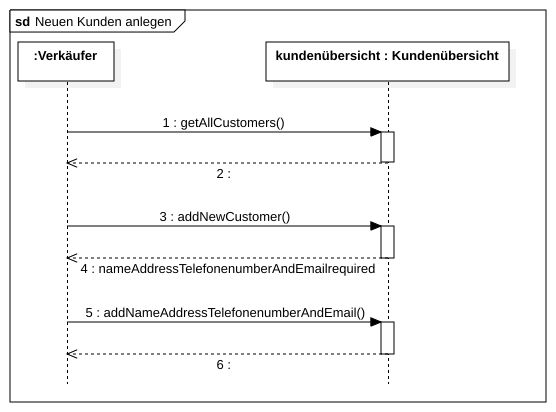

[[UC0220]]
|===
|ID                         |**<<UC0220>>**
|Name                       |Kundenübersicht zugreifen
|Description                |Die Benutzer haben Zugriff auf die Kundendaten
|Actors                     |User
|Trigger                    |Die Benutzer möchten die Kundendaten sehen
|Precondition(s)           a|Die Benutzer sind bereits authentifiziert
|Essential Steps           a|
1. Benutzer wählt "Kunden" in der Navigationsleiste
2. Die vollständige Kundenliste wird angezeigt
|Extensions                 |-
|Functional Requirements    | <<F0040>>
|===

[cols="1h,3"]
[[UC0310]]
|===
|ID                         |**<<UC0310>>**
|Name                       |Item in Warenkorb legen
|Description                |Verkäufer sollte in der Lage sein, Item im Warenkorb hinzufügen
|Actors                     |Verkäufer
|Trigger                    |Der Verkäufer möchte Produkte in den Warenkorb legen 
|Precondition(s)           a|Der Benutzer ist authentifiziert und mit dem Konto "Verkäufer" angemeldet
|Essential Steps           a|
1.  Verkäufer wählt „Katalog“ in der Navigationsleiste aus
2.  Druckt auf „details“
3.  Man wird die Produktdetails angezeigt
4.  Druckt man auf „Zum Warenkorb hinzufügen“
|Extensions                 |-
|Functional Requirements    | <<F0030>>, <<F0032>>, <<F0051>>
|===

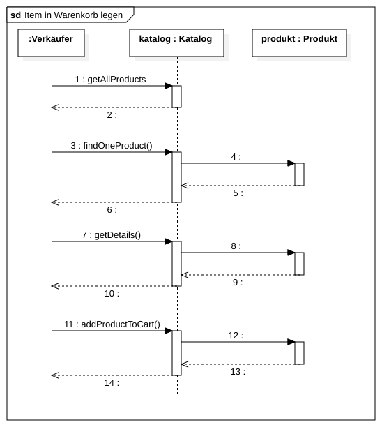

[cols="1h,3"]
[[UC0311]]
|===
|ID                         |**<<UC0311>>**
|Name                       |Kunde auswählen
|Description                |Verkäufer sollte in der Lage sein, Kunde auszuwählen 
|Actors                     |Verkäufer
|Trigger                    |Der Verkäufer möchte einen Kunden für die Produkte im Warenkorb auswählen
|Precondition(s)           a|
- Der Benutzer ist authentifiziert und mit dem Konto "Verkäufer" angemeldet
- Warenkorb ist nicht leer
|Essential Steps           a|
1.  Verkäufer wählt in der Navigationsseite „Warenkorb" 
2.  Druckt auf „Kunde“
3.  Man wird zur Navigationsleiste „Kundenübersicht“ weitergeleitet
4.  Druckt auf den Namen des Kunden
|Extensions                 |-
|Functional Requirements    | <<F0050>>, <<F0040>>
|===

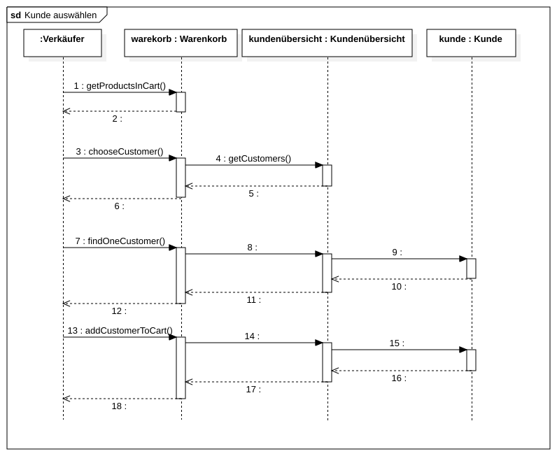

[[UC0320]]
|===
|ID                         |**<<UC0320>>**
|Name                       | Quantität des Items in Warenkorb ändern
|Description                | Der Verkäufer kann Quantität eines bestimmten Items in Warenkorb ändern
|Actors                     | Verkäufer
|Trigger                    | Der Verkäufer möchte Quantität eines bestimmten Items in Warenkorb ändern
|Precondition(s)           a| Der Benutzer ist authentifiziert und mit dem Konto "Verkäufer" angemeldet
|Essential Steps           a|
1. Verkäufer wählt in der Navigationsseite „Warenkorb"
2. Die Item im Warenkorb werden angezeigt
3. Der Verkäufer klickt auf die - oder + Button des Items, dessen Menge er ändern möchte
4. Der Verkäufer klickt auf "Quantität ändern"
6. Quantität des Items wird geändert 
|Extensions                 |-
|Functional Requirements    | <<F0051>>
|===

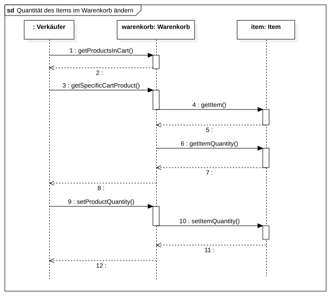

[[UC0330]]
|===
|ID                         |**<<UC0330>>**
|Name                       | Bestellung abschließen
|Description                | Der Verkäufer kann eine Bestellung abschließen
|Actors                     | Verkäufer
|Trigger                    | Der Verkäufer möchte eine Bestellung abschließen
|Precondition(s)           a| 
- Der Benutzer ist authentifiziert und mit dem Konto "Verkäufer" angemeldet
- Alle gekauften Produkte sind bereits in den Warenkorb gelegt
|Essential Steps           a|
1. Verkäufer wählt den Warenkorb aus
2. Eine Seite mit den hinzugefügten Produkten, dem Kunden und einem Knopf "Bezahlen" erscheint  
3. Betätigt "Bezahlen"
4. Eine Seite mit den Kundendaten, den sich im Warenkorb befindlichen Items, dem Endpreis, ein Feld für ein Gutscheincode und einem Knop "Bezahlen"
5. "Bezahlen" führt den Kauf aus, eine 
6. Der Einkauf wird mit den Kundendaten und den dazugehörigen gekauften Items archiviert. Die gekauften Items werden im Lager abgezogen.
|Extensions                 |-
|Functional Requirements    | <<F0055>>
|===

[[UC0340]]
|===
|ID                         |**<<UC0340>>**
|Name                       | Item aus dem Warenkorb löschen
|Description                | Verkäufer kann ein bestimmtes Item aus dem Warenkorb löschen
|Actors                     | Verkäufer
|Trigger                    | Verkäufer möchte ein bestimmtes Item aus dem Warenkorb löschen
|Precondition(s)           a| 
- Der Benutzer ist authentifiziert und mit dem Konto "Verkäufer" angemeldet
- Warenkorb ist nicht leer
|Essential Steps           a|
1. Verkäufer wählt in der Navigationsseite „Warenkorb"
2. Die Item im Warenkorb werden angezeigt
3. Verkäufer klickt auf "Löschen" Button bei Item, die gelöscht werden sollen
4. Das Bestätigungsfenster wird angezeigt
5. Verkäufer klickt auf "Bestätigen" Button
6. Item wird gelöscht 
|Extensions                 |-
|Functional Requirements    | <<F0053>>
|===

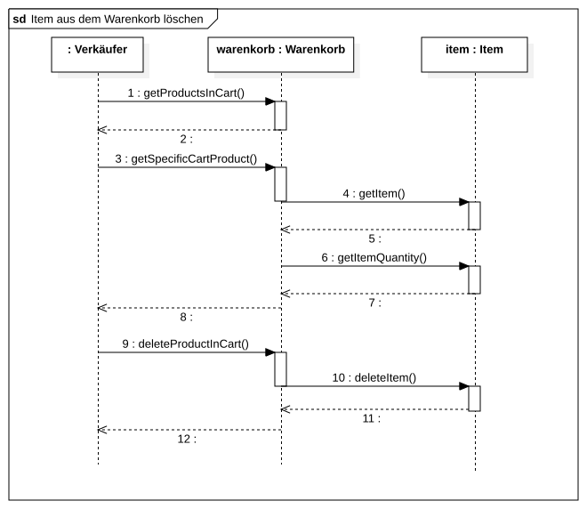

[cols="1h,3"]
[[UC0410]]
|===
|ID                         |**<<UC0410>>**
|Name                       |Lager zugreifen
|Description                |Boss und Uhrmacher sollten in der Lage sein auf das Lager zu zugreifen
|Actors                     |Uhrmacher oder Boss
|Trigger                    |Uhrmacher oder Boss wählt in der Navigationsseite „Lager" 
|Precondition(s)           a|Der Benutzer ist authentifiziert und mit dem Konto „Uhrmacher" oder „Boss" angemeldet
|Essential Steps           a|Uhrmacher oder Chef möchte die Liste der Artikel des Lagers sehen

1.  Boss oder Uhrmacher wählt in der Navigationsseite „Lager“ 

2.  Eine vollständige Liste aller Produkte mit der Menge wird angezeigt

|Extensions                 |-
|Functional Requirements    | <<F0020>>
|===

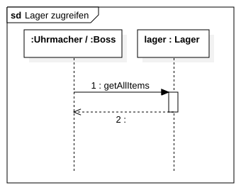

[cols="1h,3"]
[[UC0420]]
|===
|ID                         |**<<UC0420>>**
|Name                       |Neue Produkte hinfügen
|Description                |Boss sollte in der Lage sein, neue Produkte hinzufügen
|Actors                     |Boss
|Trigger                    |Boss möchte ein neues Produktk im Lager hinfügen
|Precondition(s)           a|Der Benutzer ist authentifiziert und mit dem Konto „Boss“ angemeldet
|Essential Steps           a|
1.  Boss wählt „Lager“ in der Navigationsleiste aus
2.  Eine vollständige Liste aller Produkte mit der Menge wird angezeigt
3.  Drückt auf „Erstellen“
4.  Es öffnet sich ein Fenster, in dem Bild, Name und Preis eingegeben werden können
|Extensions                 |-
|Functional Requirements    | <<F0020>>, <<F0021>>
|===
[cols="1h,3"]

[[UC0430]]
|===
|ID                         |**<<UC0430>>**
|Name                       | Produkte im Lager löschen
|Description                | Boss kann Produkt im Lager löschen
|Actors                     | Boss
|Trigger                    | Boss möchte Produkt im Lager löschen
|Precondition(s)           a| 
|Essential Steps           a| 
1.  Boss wählt „Lager“ in der Navigationsleiste aus
2.  Eine vollständige Liste aller Produkte mit der Menge wird angezeigt
3.  Boss klickt auf "Löschen" Button bei Produkten, die gelöscht werden sollen
4.  Das Bestätigungsfenster wird angezeigt
5.  Boss klickt auf "Bestätigen" Button
6.  Produkt wird gelöscht
|Extensions                 |-
|Functional Requirements    | <<F0023>>
|===
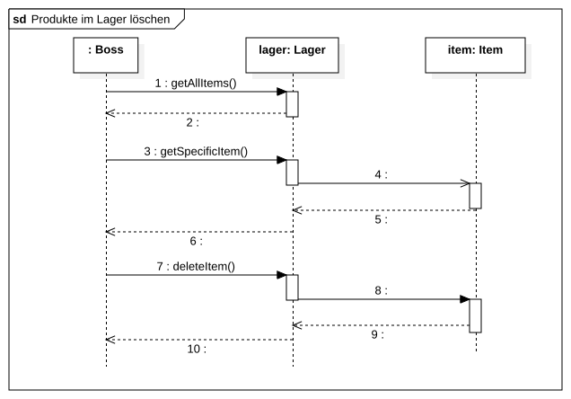

[[UC0440]]
|===
|ID                         |**<<UC0440>>**
|Name                       |Gegenstände nachbestellen
|Description                |Boss sollte in der Lage sein, Produkte wieder aufzufüllen
|Actors                     |Boss
|Trigger                    |Boss möchte den Bestand eines Items erhöhen
|Precondition(s)           a|Der Benutzer ist authentifiziert und mit dem Konto „Boss“ angemeldet
|Essential Steps           a|
1.  Boss wählt „Lager“ in der Navigationsleiste aus
2.  Eine vollständige Liste aller Produkte mit der Menge wird angezeigt
3.  Drückt man auf „Nachbestellen“ von einem Item
4.  Die Anzahl des Bestands des ausgewählten Items steigt
|Extensions                 |-
|Functional Requirements    | <<F0020>>, <<F0022>>
|===

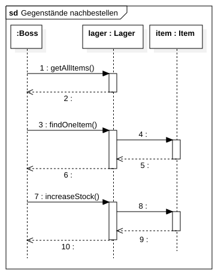

[[UC0450]]
|===
|ID                         |**<<UC0450>>**
|Name                       | Gutscheine einlösen
|Description                | Beim Einkauf kann ein Code eingelöst werden um den Endpreis zu reduzieren
|Actors                     | Verkäufer 
|Trigger                    | Ein Kunde möchte einen Gutschein für den Einkauf verwenden
|Precondition(s)           a| Der Benutzer ist authentifiziert, mit dem Konto "Verkäufer" angemeldet, ein Produkt befindet sich im Warenkorb und der Kunde besitzt     
                              einen gültigen Gutscheincode
|Essential Steps           a|
1. Verkäufer wählt den Warenkorb aus
2. Der Warenkorb mit seinem derzeitigm Inhalt wird angezeigt
3. Drückt auf "Bezahlen"
4. Ein Fenster mit dem Inhalt des Warenkorbs, dem Endpreis, ein Feld für den Gutscheincode und dem Bezahl Knopf erscheint
5. Verkäufer gibt den Gutscheincode des Kunden ein
6. Wenn der Code gültig ist wird der neue Endpreis angezeigt
|Extensions                 |-
|Functional Requirements    | <<F0054>>
|===

[cols="1h,3"]
[[UC0460]]
|===
|ID                         |**<<UC0460>>**
|Name                       |Lager History
|Description                |Boss sollte in der Lage sein, die Aktivitäten zu sehen, die im Lager durchgeführt wurden (Bestellung von Gegenstände, Löschen und Hinzufügen von Produkte, und Materialverbrauch beim Reparatur)
|Actors                     |Boss
|Trigger                    |Boss möchte den Aktivitätsverlauf im Lager sehen
|Precondition(s)           a|Der Benutzer ist authentifiziert und mit dem Konto „Boss“ angemeldet
|Essential Steps           a|
1.  Boss wählt „History und Archive“ in der Navigationsleiste aus
2.  Boss klickt auf "Lager History"
3.  die vorherige Aktivitäten im Lager wird angezeigt
|Extensions                 |-
|Functional Requirements    | <<F0024>>
|===

[[UC0510]]
|===
|ID                         |**<<UC0510>>**
|Name                       |Urlaub einreichen
|Description                |Der Mitarbeiter kann beim Chef Urlaub einreichen, der vom Chef angenommen oder abgelehnt wird
|Actors                     |Mitarbeiter
|Trigger                    |Mitarbeiter möchte Urlaub einreichen                  
|Precondition(s)           a|Der Mitarbeiter sollte im Mitarbeitersystem registriert sein
|Essential Steps           a|
1. Der Mitarbeiter greift über die Navigationsleiste auf „Urlaub“ zu
2. Der Mitarbeiter sucht und wählt seinen Namen aus der Mitarbeiterliste aus
3. Der Mitarbeiter gibt das Datum und die Dauer seines Urlaubs ein
4. Der Mitarbeiter klickt den „senden“ Button
|Extensions                 |-
|Functional Requirements    |<<F0073>> , <<F0074>>
|===

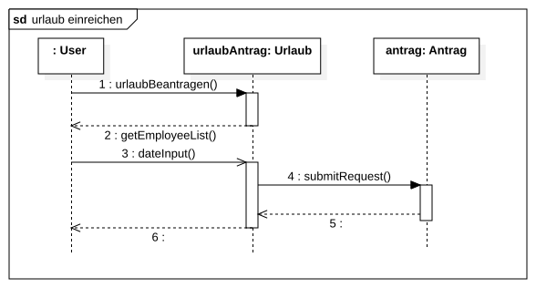

[[UC0520]]
|===
|ID                         |**<<UC0520>>**
|Name                       |Urlaub bestätigen
|Description                |Der Chef erhält den Urlaubsantrag des Mitarbeiters und kann entscheiden, ob er ihn annimmt oder ablehnt
|Actors                     |Boss
|Trigger                    |
|Precondition(s)           a|Der Benutzer ist authentifiziert und mit dem Konto "Boss" angemeldet
|Essential Steps           a|
1. Boss greift auf „Management“ in der Navigationsleiste zu
2. Chef wählt „Urlaubsantrag“ aus
3. Liste der Urlaubsanträge wird angezeigt
4. Für jede Anfrage gibt es Button zum Akzeptieren und Ablehnen. Wenn der Chef die Anfrage akzeptiert, klickt er auf die „Akzeptieren“, wenn nicht, klickt er auf „Ablehnen“.
|Extensions                 |-
|Functional Requirements    |<<F0075>>
|===

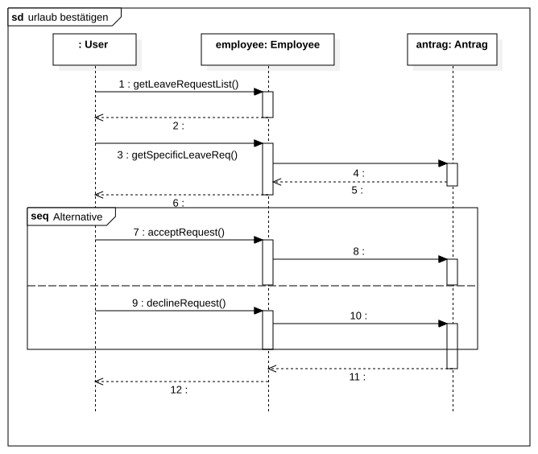

[[UC0530]]
|===
|ID                         |**<<UC0530>>**
|Name                       |Mitarbeiter kündigen und einstellen
|Description                |Der Chef kann einem Mitarbeiter kündigen oder einen neuen Mitarbeiter einstellen
|Actors                     |Boss
|Trigger                    |der Chef möchte Mitarbeiter kündigen oder einen neuen Mitarbeiter einstellen
|Precondition(s)           a|Der Mitarbeiter sollte im Mitarbeitersystem registriert sein
|Essential Steps           a|
Mitarbeiter kündigen:

1. Boss greift auf „Management“ in der Navigationsleiste zu

2. Boss öffnet die Mitarbeiterliste

3. Boss sucht und wählt den Namen aus der Liste

4. Boss klickt auf „kündigen“ Button

5. Boss bestätigt die Kündigung durch ein Pop-up window

Mitarbeiter einstellen:

1. Boss greift auf „Management“ in der Navigationsleiste zu

2. Boss öffnet die Mitarbeiterliste

3. Boss klickt auf „Neuen Mitarbeiter hinzufügen“

4. Boss füllt die Mitarbeiterdaten aus

5. Boss klickt auf „einreichen“
|Extensions                 |-
|Functional Requirements    |<<F0071>> , <<F0072>>
|===

[cols="1h,3"]
[[UC0610]]
|===
|ID                         |**<<UC0610>>**
|Name                       |Material- und Zeitverbrauch eingeben
|Description                |Uhrmacher sollte in der Lage sein, Material und Zeit einzugeben, die für die Reparatur einer Uhr benötigt werden
|Actors                     |Uhrmacher
|Trigger                    |Der Uhrmacher möchte den Zeit- und Materialaufwand für die jeweilige Reparatur eingeben
|Precondition(s)           a|Der Benutzer ist authentifiziert und mit dem Konto „Uhrmacher“ angemeldet
|Essential Steps           a|
1.  Uhrmacher loggt sich ein
2.  Drückt auf „Aufträge“ von einer Uhrmacherliste
3.  Eine Liste von Reparaturaufträge (Es gibt zwei Teile, Reparatur und Archiv) wird angezeigt
4.  Drückt auf „Abschließen“ von einem Auftrag
5.  Es öffnet sich ein Fenster, in dem man Material und Zeit für die ausgewählte Reparatur eingeben kann
|Extensions                 |-
|Functional Requirements    | <<F0010>>, <<F0060>>, <<F0061>>, <<F0062>>
|===

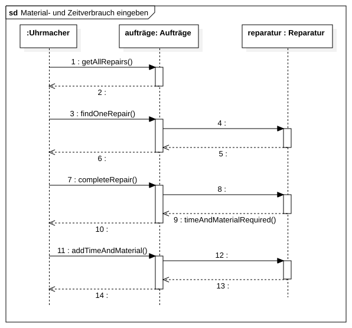

[cols="1h,3"]
[[UC0620]]
|===
|ID                         |**<<UC0620>>**
|Name                       |Aufträge zugreifen
|Description                |Uhrmacher sollte in der Lage sein, Aufträge zu zugreifen
|Actors                     |Uhrmacher
|Trigger                    |Uhrmacher möchte die Auftragsübersicht sehen
|Precondition(s)           a|Der Benutzer ist authentifiziert und mit dem Konto „Uhrmacher“ angemeldet
|Essential Steps           a|
1.  Uhrmacher loggt sich ein  
2.  Drückt auf „Aufträge“ von einer Uhrmacherliste
3.  Eine Liste von Reparaturaufträge (Es gibt zwei Teile, Reparatur und Archiv) wird angezeigt
4.  Wenn eine Reparatur abgeschlossen ist, geht der Reparaturauftrag in den Archivteil
|Extensions                 |-
|Functional Requirements    | <<F0010>>, <<F0060>>, 
|===

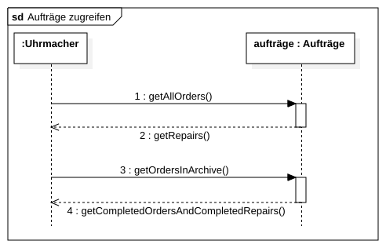

[[UC0630]]
|===
|ID                         |**<<UC0630>>**
|Name                       |Auftrag abschließen
|Description                |Uhrmacher sollte in der Lage sein, Auftrag, der schon fertig ist, abzuschließen
|Actors                     |Uhrmacher
|Trigger                    |Uhrmacher möchte den fertig gearbeiteten Auftrag abschließen
|Precondition(s)           a|
-Der Benutzer ist authentifiziert und mit dem Konto „Uhrmacher“ angemeldet
-Auftrag ist schon fertig gearbeitet
|Essential Steps           a|
1.  Uhrmacher loggt sich ein  
2.  Drückt auf „Aufträge“ von einer Uhrmacherliste
3.  Eine Liste von Reparaturaufträge (Es gibt zwei Teile, Reparatur und Archiv) wird angezeigt
4.  Wenn eine Reparatur abgeschlossen ist, klickt der Uhrmacher "Abschließen"
5.  Der Auftrag wird in Auftarg Archiv gespeichert
|Extensions                 |-
|Functional Requirements    | <<F0062>>, <<F0063>>, 
|===

[[UC0710]]
|===
|ID                         |**<<UC0710>>**
|Name                       |Archiv der Einkäufe
|Description                |Boss sollte in der Lage sein, Archiv von abgeschlossene Einkäufe anzusehen
|Actors                     |Boss
|Trigger                    |Boss möchte die Kaufhistorie sehen
|Precondition(s)           a|Der Benutzer ist authentifiziert und mit dem Konto „Boss“ angemeldet
|Essential Steps           a|
1.  Boss wählt „History und Archive“ in der Navigationsleiste aus
2.  Boss klickt auf "Einkauf Archiv"
3.  die Kaufhistorie wird angezeigt
|Extensions                 |-
|Functional Requirements    | <<F0063>>
|===

[[UC0720]]
|===
|ID                         |**<<UC0720>>**
|Name                       |Archiv der Aufträge
|Description                |Boss sollte in der Lage sein, Archiv von abgeschlossene Reparaturaufträge anzusehen
|Actors                     |Boss
|Trigger                    |Boss möchte die Auftraghistorie sehen
|Precondition(s)           a|Der Benutzer ist authentifiziert und mit dem Konto „Boss“ angemeldet
|Essential Steps           a|
1.  Boss wählt „History und Archive“ in der Navigationsleiste aus
2.  Boss klickt auf "Auftrag Archiv"
3.  die Auftraghistorie wird angezeigt
|Extensions                 |-
|Functional Requirements    | <<F0063>>, 
|===

== 8. Funktionale Anforderungen

=== a. Muss-Kriterien

[options="header", cols="2h, 3, 12"]
|===
|ID
|Name
|Beschreibung

|[[F0010]]<<F0010>>
|Log-in für Boss, Uhrmacher, Verkäufer
a|
Das System ist in eine Log-In Seite gegliedert die dann je nach Authentifizerung die Bereiche und Komponenten für die Gruppen: Boss, Verkäufer und Uhrenmacher freischaltet. Unauthentifizerte User sehen, unter anderem zum Datenschutz, nur die Log-In Seite. Die User können sich mit folgenden Informationen authentifizieren:

* Nutzername
* Passwort

|[[F0011]]<<F0011>>
|Log-out für alle
a|
Das System soll dazu in der Lage sein User abzumelden.

|[[F0020]]<<F0020>>
|Lager
a|
Das System soll in der Lage sein alle Items dauerhaft zu speichern und aufzulisten. Das Lager ist aus einem Header und den darunter mit ihren Informationen aufgelisteten Items aufgebaut. Zu jedem Item gibt es unter anderem folgende Informationen:

* ID
* Name
* Quantität
* Preis
* Beschreibung

Nur die User "Boss" und "Uhrenmacher" können auf diese Komponente zugreifen

|[[F0021]]<<F0021>>
|Lager Item erstellen
a|
Das System soll in der Lage sein im Lager unter Angabe von Informationen durch den User "Boss" ein neues Item hinzuzufügen.

Nur der User "Boss" ist dazu Autorisiert.

|[[F0022]]<<F0022>>
|Lager Item nachbestellen
a|
Das System soll in der Lage sein spezifische Items aus dem Lager nachzubestellen und ihre Quantität so zu erhöhen.

Nur der User "Boss" ist dazu Autorisiert.

|[[F0023]]<<F0023>>
|Lager Item löschen
a|
Das System soll in der Lage sein spezifische Items aus dem Lager zu löschen.

Nur der User "Boss" ist dazu Autorisiert.

|[[F0024]]<<F0024>>
|Lager Aktivitätenliste
a|
Das System soll in der Lage sein selbständig eine Liste mit allen Aktivitäten des Lagers zu erstellen und zu speichern. Die Liste enthält unter anderem folgenede Informationen:

* Typ der Änderung(z.B.: Nachbestellung, Kauf,...)
* Itemname des geänderten Items
* Eigentliche Änderung(z.B.: Quantität 10 -> 20)

Nur der User "Boss" kann auf diese Komponente zugreifen.

|[[F0025]]<<F0025>>
|Benachrichtigung niedriger Lagerstand
a|
Das System soll in der Lage sein selbständig die Quantität aller Items im Lager zu überwachen und dem User "Boss" eine Benachrichtigung anzuzeigen falls eine dieser Quantitäten auf einen sehr niedrigen Stand fällt.

Nur der User "Boss" ist dazu Autorisiert.

|[[F0030]]<<F0030>>
|Katalog
a|
Das System soll in der Lage sein alle Produkte aus dem Lager in einem Katalog aufzuführen. Der Katalog ist aus einem Header in dem unteranderem eine Suchleiste zu finden ist, und den in Kachelform aufgelisteten Produkten aufgebaut. Zu den Produkten werden in ihrer jeweiligen Kachel folgende Informationen gezeigt:

* Bild
* Name
* Preis

Nur die User "Boss" und "Verkäufer" können auf diese Komponente zugreifen.

|[[F0031]]<<F0031>>
|Suchfunktion innerhalb des Katalog
a|
Das System soll in der Lage sein im Katalog eine Suchfunktion auszuführen.

Nur die User "Boss" und "Verkäufer" sind dazu autorisiert.

|[[F0032]]<<F0032>>
|Detailfenster einzelner Produkte im Katalog
a|
Das System soll in der Lage sein zu jedem Item im Katalog eine Detailseite aufzurufen, diese beinhaltet unteranderem: 

* Name
* Preis
* Bestand
* Beschreibung
* Bild
* Ein Feld zum auswählen einer Quantität und dem anschließenden hinzufügen zum Warenkorb.

Nur die User "Boss" und "Verkäufer" können diese Komponente aufrufen.

|[[F0033]]<<F0033>>
|Gutscheine erstellen
a|
Der User "Verkäufer" soll mit dem System in der Lage sein Gutscheine mit bestimmten Guthaben zu generieren.

Nur die User "Boss" und "Verkäufer" ist dazu Autorisiert.

|[[F0040]]<<F0040>>
|Kundendaten
a|
Das System soll in der Lage sein verschiedene Kunden(Datensätze) dauerhaft zu speichern. Ein Datensatz besteht unter anderem aus:

* Vorname
* Nachname
* Anschrift
* Telefonnummer
* E-Mail

Nur die User "Boss" und "Verkäufer" können diese Komponente aufrufen.

|[[F0041]]<<F0041>>
|Erstellen eines neuen Kunden
a|
Das System soll in der Lage sein unter angabe der benötigten Informationen einen Kunden(Datensatz) anzulegen und zu speichern.

Nur die User "Boss" und "Verkäufer" sind dazu autorisiert.

|[[F0050]]<<F0050>>
|Warenkorb
a|
Das System soll in der Lage sein dem User "Verkäufer" und "Boss" einen jeweils einzigartigen Warenkorb zur Verfügung zu stellen in dem ausgewählte Items temporär gespeichert werden können. Der Warenkorb ist aus einer Kundenauswahl, in der der aktuelle Kunde ausgewählt sein muss, der Produktübersicht, dem Gesammtpreis aller Items im Warenkorb und einem "Kaufen" Button aufgebaut. Die Produktübersicht listet für jedes Item im Warenkorb unter anderem folgende Informationen:

* Name
* Quantität
* Preis(Itempreis*Quantität)

Nur die User "Boss" und "Verkäufer" können diese Komponente aufrufen.

|[[F0051]]<<F0051>>
|Items in den Warenkorb legen
a|
Das System soll in der Lage sein vom User aus dem Katalog über die Detailseite ausgewählte Items in gewünschter Quantität in seinen Warenkorb zu legen.

Nur die User "Boss" und "Verkäufer" sind dazu autorisiert.

|[[F0052]]<<F0052>>
|Quantität eines Items im Warenkorb verändern
a|
Das System soll in der Lage sein die Quantität eines einzelnen Items im Warenkorb zu vergrößern oder zu verkleinern.

Nur die User "Boss" und "Verkäufer" sind dazu autorisiert.

|[[F0053]]<<F0053>>
|Item aus dem Warenkorb löschen.
a|
Das System soll in der Lage sein ein spezifisches Item aus dem Warenkorb zu entfernen.

Nur die User "Boss" und "Verkäufer" sind dazu autorisiert.

|[[F0054]]<<F0054>>
|Gutscheine einlösen
a|
Der User "Verkäufer" soll mit dem System in der Lage sein Gutscheine für eine bestimmte Bestellung einzulösen.

Nur die User "Boss" und "Verkäufer" ist dazu Autorisiert.

|[[F0055]]<<F0055>>
|Eine Bestellung abschließen
a|
Das System soll in der Lage sein eine Bestellung im Warenkorb abzuschließen. Dabei Prüft es ob im Warenkorb das Item "Reparatur" liegt. 

Falls dieser Fall zutrifft erstellt das System aus den vorhandenen Informationen im Warenkorb, wie z.B.: Kundenkonto oder Art der Reparatur, einen Reparaturauftrag und sendet diesen zur Aufgabenverteilung. 

Falls dieser Fall nicht zutrifft wird ein Kaufbeleg erstellt. In diesem Fall wird geprüft ob alle Items in gewünschter Quantität vorhanden sind, falls ja, wird die Quantität der bestellten Items aus dem Lager entfernt. Aus den vorhanden Informationen im Warenkorb, wie z.B.: Kundenkonto, eine Liste der gekauften Artikel oder dem Gesammtpreis, wird ein Kaufbeleg erstellt und dieser zum Archiv gesendet.

Nur die User "Boss" und "Verkäufer" sind dazu autorisiert.

|[[F0060]]<<F0060>>
|Reparatur&Archiv
a|
Das System soll in der Lage sein eine Übersicht über alle sich in Arbeit befindlichen und abgeschlossenen Reparaturen und die Historie der Verkäufe zur Verfügung zu stellen. Diese Übersicht ist in 2 Teile aufgeteilt:

* Die Reparaturübersicht
* Das Archiv

|[[F0061]]<<F0061>>
|Reparaturübersicht
a|
Das System soll in der Lage sein alle aktuellen Reparaturaufträge aufzulisten und gleichmäßig unter beachtung bestimmter Vorausetzungen unter den Uhrenmachern zu verteilen. Die Übersicht besteht aus den jeweiligen Namen der Uhrenmacher, bei anklicken eines Namen werden die dem Uhrmacher zugteilten Aufträge angezeigt.

|[[F0062]]<<F0062>>
|Reparaturauftrag
a|
Das System soll in der Lage sein einen Reparaturauftrag zu erstellen und zu speichern. In einem Auftrag werden die jeweiligen Informationen aus dem Warenkorb, wie bereits in <<F0054>> gennant, gespeichert. Wenn ein Uhrmacher mit einem Auftrag fertig ist kann er Preis der Reparatur und die verbrauchten Materiallien angeben, dannach wird der abgeschlossene Auftrag an das Archiv gesendet.

|[[F0063]]<<F0063>>
|Archiv
a|
Das System soll in der Lage sein alle abgeschlossenen Reparaturaufträge und Verkäufe, mit ihren zuvor in <<F0054>> gennanten Informationen, in Listenform dauerhaft zu speichern.

|[[F0070]]<<F0070>>
|Personalverwaltung
a|
Das System soll in der Lage sein alle Mitarbeiter(Datensatz) und die Informationen zu ihnen aufzulisten und dauerhaft zu speichern. Zu den Informationen gehören unter anderem:

* Name
* Anschrift
* Alter
* Telefonnummer
* E-Mail
* Gehalt
* Rolle

|[[F0071]]<<F0071>>
|Mitarbeiter anstellen
a|
Das System soll in der Lage sein unter Angabe von Informationen durch den User "Boss" einen Mitarbeiter(Datensatz) anzulegen und dauerhaft zu speichern.

Nur der User "Boss" ist dazu Autorisiert.

|[[F0072]]<<F0072>>
|Mitarbeiter feuern
a|
Das System soll in der Lage sein einen spezifischen Mitarbeiter(Datensatz) zu löschen.

Nur der User "Boss" ist dazu Autorisiert.

|[[F0073]]<<F0073>>
|Urlaub beantragen
a|
User des Typs "Uhrmacher" und "Verkäufer" sollen über das System in der Lage sein unter Angabe ihrer Mitarbeiterdaten an den User "Boss" einen Urlaubsantrag zu senden.

Nur die User "Uhrenmacher" und "Verkäufer" sind dazu Autorisiert.

|[[F0074]]<<F0074>>
|Urlaubsanträge
a|
Das System soll in der Lage sein Urlaubsanträge zu erstellen, zu speichern und in Listenform anzuzeigen. Die Informationen in einem Urlaubsantrag sind unter anderem:

* Start- und Enddatum des Urlaubs
* Name des Antragstellers(so wie weitere Informationen)

|[[F0075]]<<F0075>>
|Urlaub bestätigen
a|
Der User "Boss" soll mit dem System in der Lage sein sich die erstellten Urlaubsanträge anzusehen und sie zu autorisieren oder zu löschen.

Nur der User "Boss" ist dazu Autorisiert.

|===

=== b. Kann-Kriterien

[options="header", cols="2h, 3, 12"]
|===
|ID
|Name
|Beschreibung

|[[K0010]]<<K0010>>
|Turmuhren
a|
Das System soll in der Lage sein die Reparatur von Turm- und Gebäudeuhren verwalten zu können. Dazu gehören das Erstellen,Anzeigen und bearbeiten von spezielen Verträgen und Reparaturaufträgen sowie das festlegen eines Pauschalbetrages, das hinzufügen neuer Materiallien zur Reparatur und die möglichkeit mehr Mitarbeiter zu verwalten.

|[[K0020]]<<K0020>>
|Mitarbeiter können Kündigen
a|
Das System soll in der Lage sein das die User "Verkäufer" und "Uhrenmacher" selber auf der seite der Mitarbeiterverwaltung eine Kündigung einreichen können. Der User "Boss" kann dieser dann bestätigen.

|[[K0030]]<<K0030>>
|Mitarbeiterdaten bearbeiten
a|
Das System soll dem User "Boss" ermöglichen den Datensatz spezifischer Mitarbeiter zu bearbeiten.

|===

== 9. Nicht-Funktionale Anforderungen

=== a. Qualitätsziele

Die folgende Tabelle zeigt, welche Qualitätsanforderungen in welchem Umfang erfüllt werden müssen.

[options="header", cols="3h, ^1, ^1, ^1, ^1, ^1"]
|===
|Qualtitätsanforderung    | 1 | 2 | 3 | 4 | 5
|Benutzbarkeit            |   |   | x |   |
|Effizienz                |   |   |   | x |
|Korrektheit              |   |   |   | x |
|Robustheit               |   |   |   | x |
|Security                 |   | x |   |   |
|===

=== b. Konkrete Nicht-Funktionale Anforderungen
(Erfüllung mindestens theoretisch)

[options="header", cols="2h, 3, 12"]
|===
|ID
|Name
|Beschreibung

|[[NF0010]]<<NF0010>>
|Benutzbarkeit
a|
Das System soll einfach zu handhaben sein und eine gute Verständlichkeit bieten.

|[[NF0020]]<<NF0020>>
|Effizienz
a|
Das System soll eine niedrige Reaktionszeit vorweisen um flüssiges und schnelles Arbeiten zu ermöglichen.

|[[NF0030]]<<NF0030>>
|Korrektheit
a|
Es sollen innerhalb des Systems Daten richtig übertragen und Befehle ohne fehler ausgeführt werden.

|[[NF0040]]<<NF0040>>
|Robustheit
a|
Das System muss eine Betriebszeit von mindestens 99,5 % erreichen.

|[[NF0050]]<<NF0050>>
|Sicherheit
a|
Eingeloggte User sollen nur die für sie bestimmten Komponenten sehen.

|===

== 10. GUI Prototyp
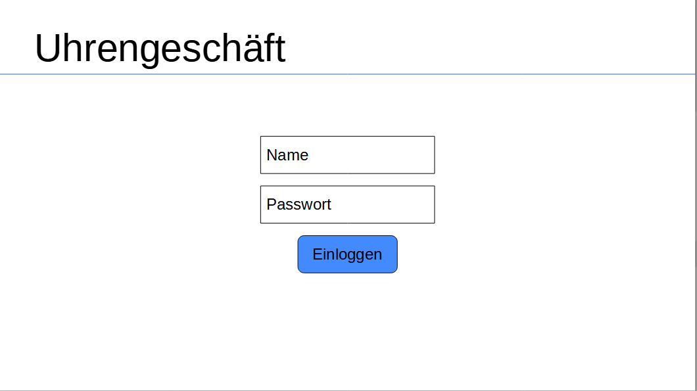
Login Bildschirm für alle User

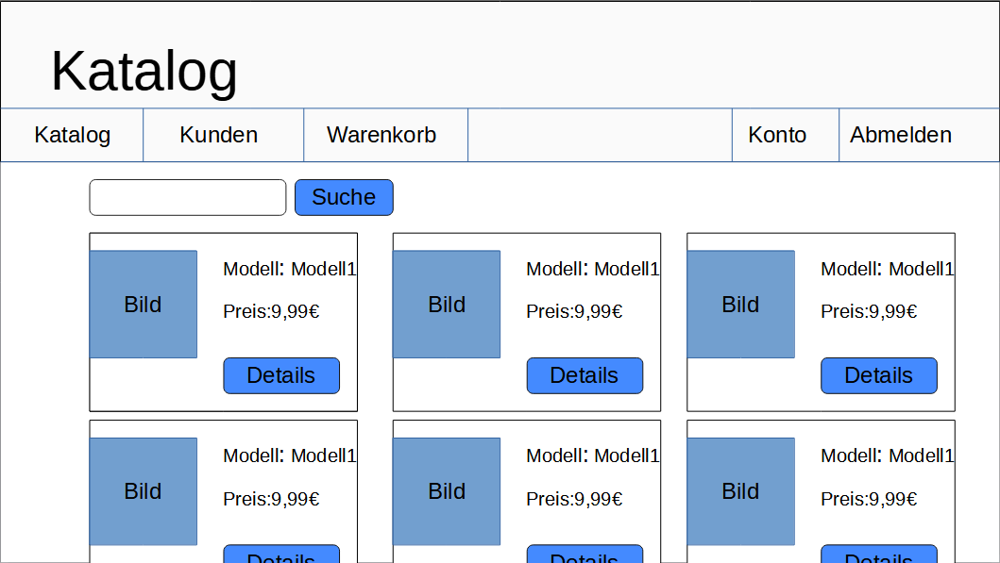
Verkäufer: Katalog Ansicht 

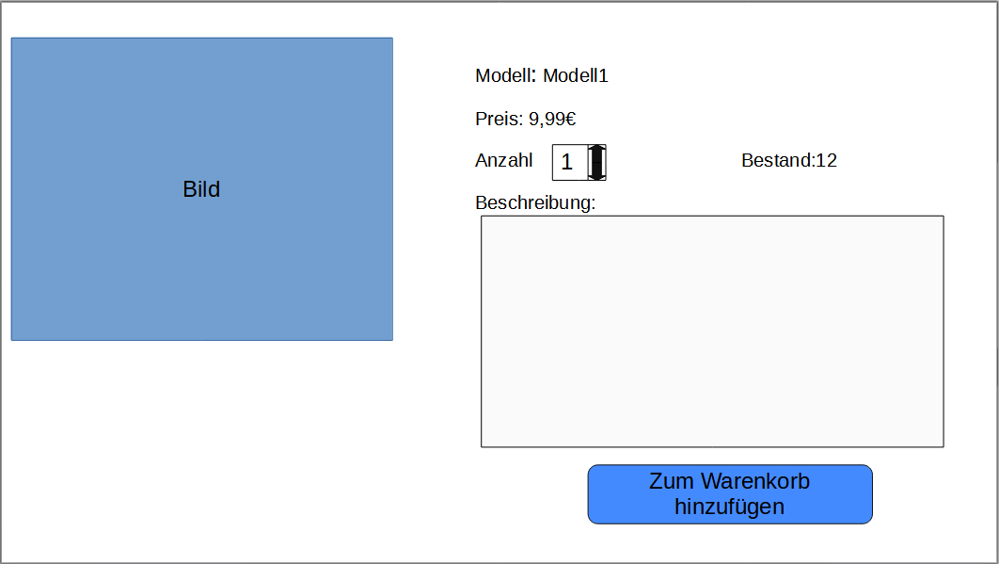
Detailsseite für die Produkte

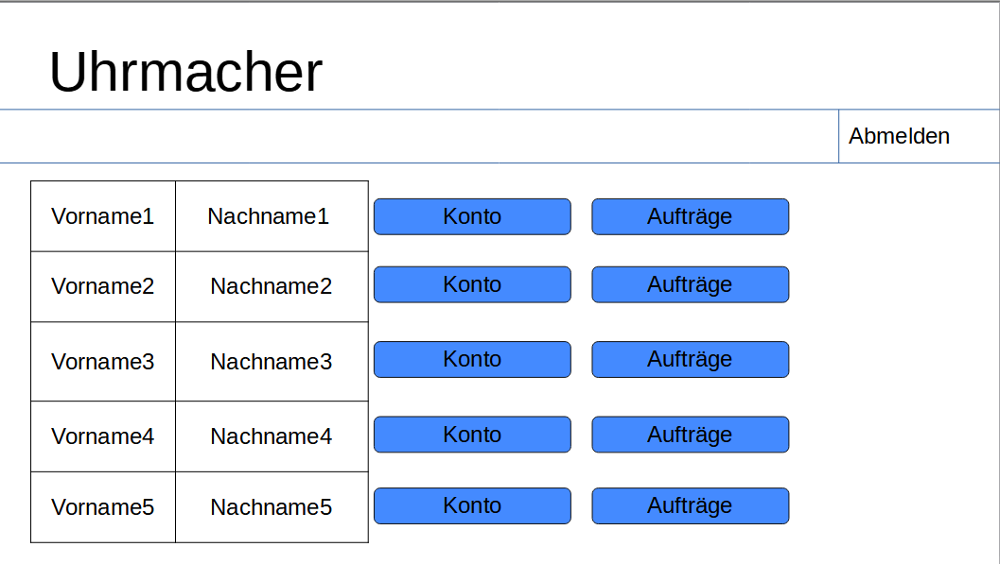
Uhrmacher: Seite nach der Anmeldung 

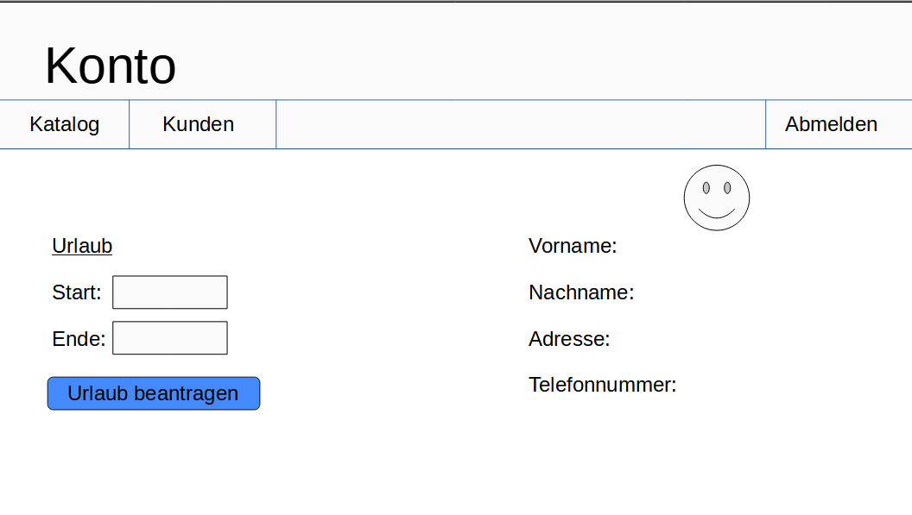
Verkäufer:Urlaubsbeantragung 

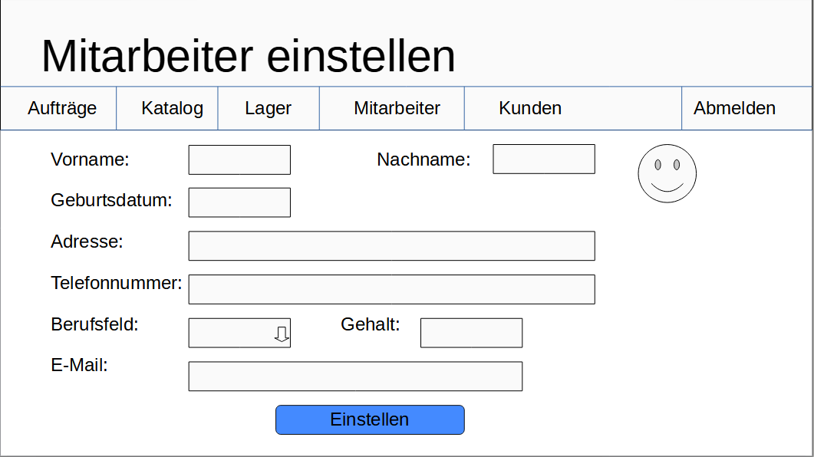
Boss: Mitarbeiter einstellen

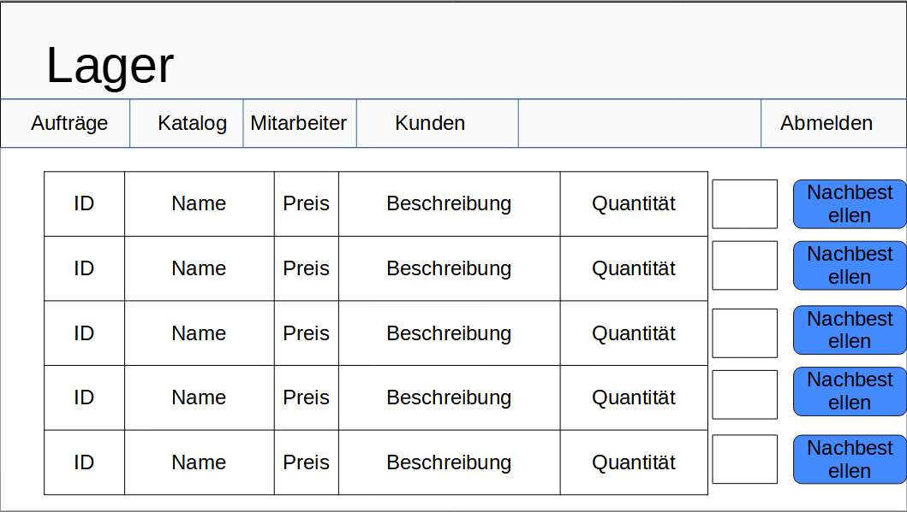
Boss: Lager Ansicht

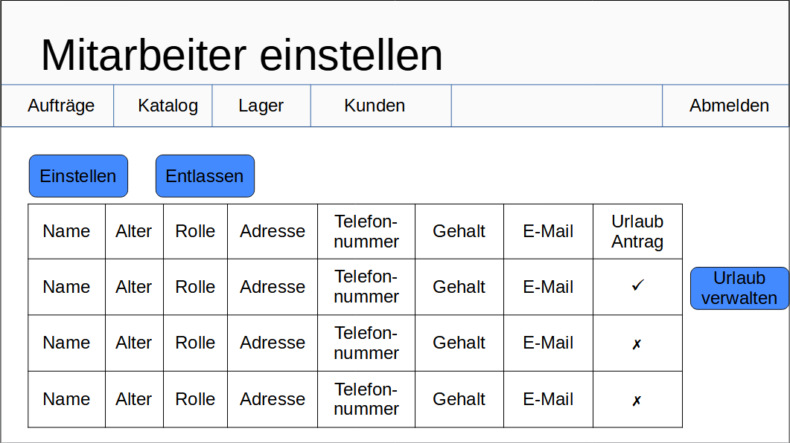
Boss: Mitarbeiter Übersicht

=== a. Überblick: Dialoglandkarte
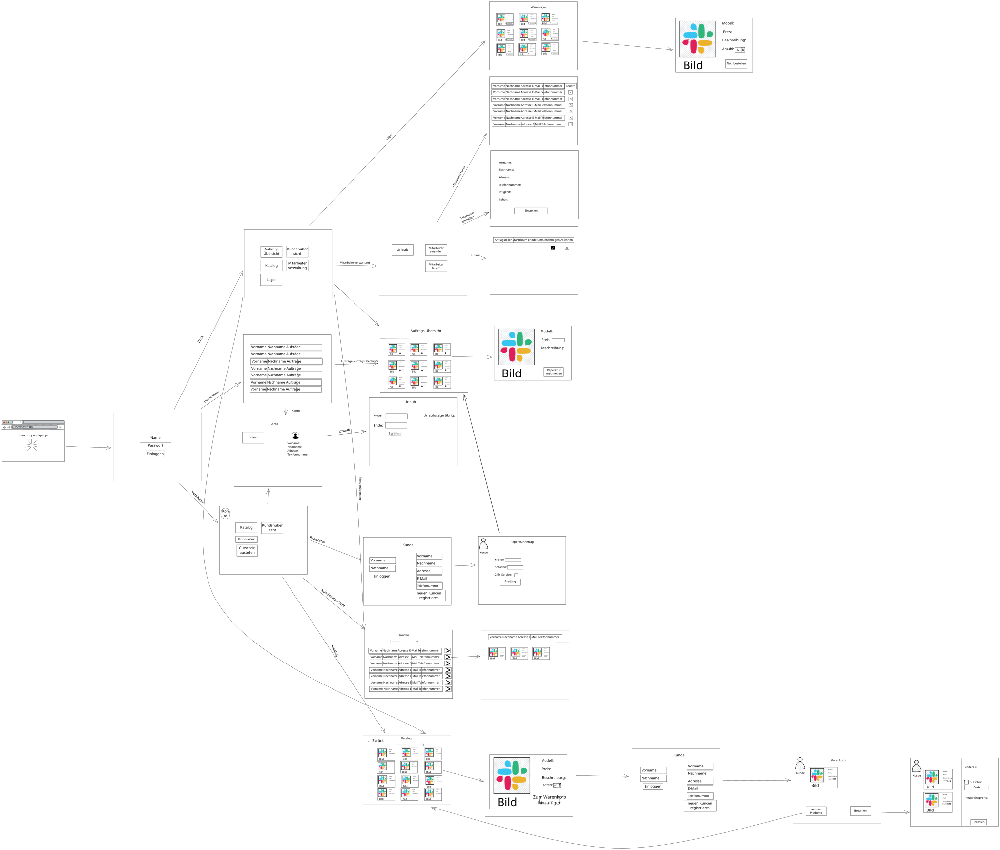

=== b. Dialogbeschreibung
Für jeden Dialog:

1. Kurze textuelle Dialogbeschreibung eingefügt: Was soll der jeweilige Dialog? Was kann man damit tun? Überblick?
2. Maskenentwürfe (Screenshot, Mockup)
3. Maskenelemente (Ein/Ausgabefelder, Aktionen wie Buttons, Listen, …)
4. Evtl. Maskendetails, spezielle Widgets

== 11. Datenmodell

=== a. Überblick: Klassendiagramm
UML-Analyseklassendiagramm
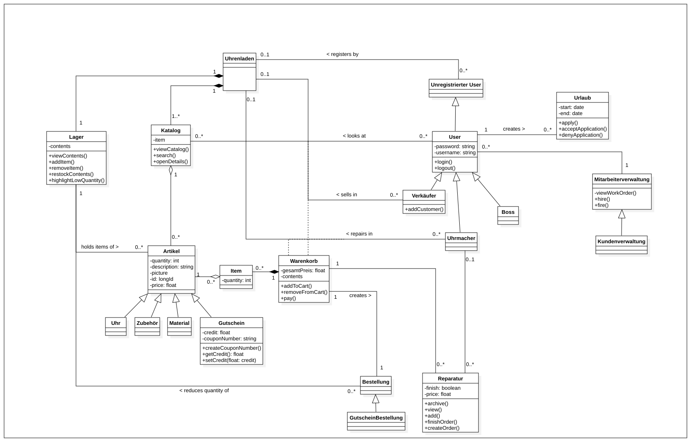

=== b. Klassen und Enumerationen

// See http://asciidoctor.org/docs/user-manual/#tables
[options="header"]
|===
|Klasse/Enumeration |Beschreibung 
|Uhrenladen              |Zentrale Klasse des Systems, die den Uhrenladen selbst darstellt.
|Unregistrierter User              |Allgemeine Darstellung einer realen Person, die noch nicht im System registriert ist.
|User                   |Allgemeine Darstellung einer realen Person.
|Verkäufer                   |Ein User, der als Verkäufer agiert. 
|Uhrmacher                  |Ein User, der als Uhrmacher agiert.
|Boss                  |Ein User, der als Administrator/Boss des Uhrladens registriert ist.
|Urlaub                 |Die Klasse Urlaub erlaubt es den Usern Urlaub einzureichen.
|Mitarbeiterverwaltung                 |Bei der Mitarbeiterverwaltung hat der Boss die Möglichkeit, seine Mitarbeiter zu verwalten(neue Einstellen, bestehende kündigen und über den Urlaub zu entscheiden)
|Katalog                 |Ein Katalog ist eine Gruppe von Artikeln mit einem gemeinsamen Merkmal.
|Artikel                    |Allgemeines Produkt des Uhrladens.
|Uhr                |Eine Uhr ist ein möglicher Artikel-Typ, der verwendet wird, um Artikel im Katalog zu gruppieren.
|Zubehör                |Ein Zubehör ist ein möglicher Artikel-Typ, der verwendet wird, um Artikel im Katalog zu gruppieren.
|Material                   |Materialien sind mögliche Artikel-Typen, die verwendet werden, um Artikel im Katalog zu gruppieren.
|Item              |Stellt die Menge eines Artikels im Warenkorb dar.
|Warenkorb                  |Ein Warenkorb ist ein temporärer Speicher für Artikel, die ein Kunde zu kaufen beabsichtigt und vom Verkäufer in den Warenkorb gelegt werden. Wenn ein Kunde sich entscheidet, die von ihm ausgewählten Artikel zu kaufen, wird eine Bestellung erstellt. 
|Bestellung            |Eine Bestellung wird verwendet, um darzustellen, was ein Kunde des Shops zu kaufen beabsichtigt.
|Lager             |Ein Lager stellt ein Warenbestand für den Uhrenladen dar. Es kann wie ein Lagerhaus in diesem Projekt gesehen werden.
|Reparatur             |Bei der Reparatur sieht der Uhrmacher die wichtigen Details des Auftrags und fügt die verwendeten Materialien hinzu.
|Kundenverwaltung              |Bei der Kundenverwaltung können die Mitarbeiter alle registrierten Kunden Verwalten 
|GutscheinBestellung              |Die GutscheinBestellung ist eine Auflistung aller gekaufeten Gutscheine.
|Gutschein              |Ein Gutschein ist ein möglicher Artikel-Typ, der verwendet wird, um Artikel im Katalog zu gruppieren.
|===

== 12. Akzeptanztestfälle

:Pre: Precondition(s)
:Event: Event
:Result: Expected Result

[cols="1h, 4"]
|===
|ID            |<<AT0010>>
|Use Case      |<<UC0010>>
|{Pre}        a|Das System hat 3 Konten (Boss, Verkäufer, Uhrmacher)
|{Event}      a|Ein nicht authentifizierter Benutzer greift auf den Anmeldebildschirm zu, gibt die Anmeldeinformationen eines bestehenden Benutzers des Systems ein ("Rolle", "Passwort") und drückt auf "Anmelden".
|{Result}     a|
- Der Benutzer ist nun in seiner Rolle authentifiziert
- Der Benutzer wird mit der Navigationsleiste auf einen leeren Bildschirm umgeleitet (Die Navigationsleiste ist für jede Rolle unterschiedlich)
- Der Uhrmacher wird auf einen Bildschirm mit einer Liste der Namen des Uhrmachers umgeleitet. Neben dem Namen befindet sich einen Button zum Beantragen des Urlaubs und daneben einen Button zum Aufrufen der Bestellübersicht
- Der Benutzer hat nun Zugriff auf alle Funktionen, die seiner Rolle zugänglich sind
|===

[cols="1h, 4"]
|===
|ID            |<<AT0020>>
|Use Case      |<<UC0020>>
|{Pre}        a|Ein authentifizierter Benutzer verwendet das System
|{Event}      a|Der authentifizierte Benutzer drückt auf "Ausloggen"
|{Result}     a|
- Er wird nicht authentifiziert
- Er verliert jeglichen Zugriff auf Funktionen, die nur authentifizierten Benutzern oder bestimmten Rollen offen stehen
|===

[cols="1h, 4"]
|===
|ID            |<<AT0110>>
|Use Case      |<<UC0110>>
|{Pre}        a|Ein Verkäufer verwendet das System und sieht sich den Katalog an
|{Event}      a|Der Verkäufer drückt auf "Details" von einem Item
|{Result}     a|Produktdetails werden angezeigt
|===

[cols="1h, 4"]
|===
|ID            |<<AT0120>>
|Use Case      |<<UC0120>>
|{Pre}        a|Ein Verkäufer verwendet das System
|{Event}      a|Der Verkäufer drückt auf "Katalog" in der Navigationsleiste
|{Result}     a|Eine Liste der Produkte wird angezeigt
|===

[cols="1h, 4"]
|===
|ID            |<<AT0130>>
|Use Case      |<<UC0130>>
|{Pre}        a|Ein Verkäufer verwendet das System und sieht sich den Katalog an
|{Event}      a|Der Verkäufer wählt einen Gutschein aus und fügt den Betrag hinzu
|{Result}     a|Gutscheincode wird generiert (Man kann den Code im Warenkorb löschen)
|===

[cols="1h, 4"]
|===
|ID            |<<AT0140>>
|Use Case      |<<UC0140>>
|{Pre}        a|Ein Verkäufer verwendet das System und sieht sich den Katalog an
|{Event}      a|Der Verkäufer gibt den Namen des Produkts in die Suchleiste ein und druckt auf "Suchen"
|{Result}     a|Das gesuchte Produkt wird angezeigt
|===

[cols="1h, 4"]
|===
|ID            |<<AT0210>>
|Use Case      |<<UC0210>>
|{Pre}        a|Ein Verkäufer verwendet das System und sieht sich die Kundenübersicht an
|{Event}      a|Der Verkäufer drückt auf „Neuer Kunde hinzufügen“ und gibt folgende Informationen ein:

- _Name:_ TestCustomer
- _Adresse:_ Nöthnitzer Straße 46
- _Telefonnummer:_ 0123456789
- _Email:_ customer.test@mail.de

Abschließend drückt er auf „Registrieren“, um die Informationen abzusenden.
|{Result}     a|
- Ein neuer Kunde mit den bereitgestellten Daten wird erstellt
- Es ist möglich, an diesen Kunden zu verkaufen
|===

[cols="1h, 4"]
|===
|ID            |<<AT0220>>
|Use Case      |<<UC0220>>
|{Pre}        a|Ein Verkäufer oder Boss verwendet das System
|{Event}      a|Der Verkäufer oder Boss drückt in der Navigationsleiste auf „Kunden“.
|{Result}     a|Eine Liste von Kundennamen, Adressen, Telefonnummern und E-Mail-Adressen wird angezeigt
|===

[cols="1h, 4"]
|===
|ID            |<<AT0310>>
|Use Case      |<<UC0310>>
|{Pre}        a|Ein Verkäufer verwendet das System und sieht sich die Produktdetails an
|{Event}      a|Der Verkäufer drückt auf "Zum Warenkorb hinzufügen"
|{Result}     a|Produkt wird in den Warenkorb gelegt
|===

[cols="1h, 4"]
|===
|ID            |<<AT0311>>
|Use Case      |<<UC0311>>
|{Pre}        a|Ein Verkäufer verwendet das System und sieht sich den Warenkorb an
|{Event}      a|
- Der Verkäufer drückt auf "Kunde" und wird zur Navigationsleiste „Kundenübersicht“ weitergeleitet
- Der Verkäufer druckt auf den Namen des Kundes
|{Result}     a|Ein Kunde für die Produkte im Warenkorb wird ausgewählt
|===

[cols="1h, 4"]
|===
|ID            |<<AT0320>>
|Use Case      |<<UC0320>>
|{Pre}        a|Ein Verkäufer verwendet das System und sieht sich den Warenkorb an
|{Event}      a|Der Verkäufer drückt die "+" oder "-" Button eines Items und druckt auf "Quantität ändern"
|{Result}     a|Quantität des Items wird geändert
|===

[cols="1h, 4"]
|===
|ID            |<<AT0330>>
|Use Case      |<<UC0330>>
|{Pre}        a|Ein Verkäufer verwendet das System und sieht sich den Warenkorb an
|{Event}      a|
- Der Verkäufer drückt "Bezahlen" und wird zur Navigationsleiste „Kundenübersicht“ weitergeleitet
- Ein Verkäufer wird auf eine Seite mit den Bestelldetails umgeleitet
- Der Verkäufer druckt wieder auf "Bezahlen"
|{Result}     a|Der Einkauf wird mit den Kundendaten und den dazugehörigen gekauften Items archiviert. Die gekauften Items werden im Lager abgezogen.
|===

[cols="1h, 4"]
|===
|ID            |<<AT0340>>
|Use Case      |<<UC0340>>
|{Pre}        a|Ein Verkäufer verwendet das System und sieht sich den Warenkorb an
|{Event}      a|Der Verkäufer drückt auf "Löschen" von einem Item. Das Bestätigungsfenster wird angezeigt
|{Result}     a|Druckt der Boss auf "Bestätigen" Button, dann wird das Item gelöscht 
|===

[cols="1h, 4"]
|===
|ID            |<<AT0410>>
|Use Case      |<<UC0410>>
|{Pre}        a|Ein Uhrmacher oder Boss verwendet das System
|{Event}      a|Der Uhrmacher oder Boss drückt auf "Lager" in der Navigationsleiste
|{Result}     a|Eine vollständige Artikelliste mit ID, Name, Menge, Preis und Beschreibung wird angezeigt
|===

[cols="1h, 4"]
|===
|ID            |<<AT0420>>
|Use Case      |<<UC0420>>
|{Pre}        a|Boss verwendet das System und sieht sich das Lager an
|{Event}      a|
- Der Boss drückt auf "Neue Produkte hinfügen"
- Es öffnet sich ein Fenster, in dem Boss ID, Name, Preis, Beschreibung und Quantität eingeben kann
- Der Boss druckt auf "OK"
|{Result}     a|Ein neues Produkt wird im Lager hinzugefügt
|===

[cols="1h, 4"]
|===
|ID            |<<AT0430>>
|Use Case      |<<UC0430>>
|{Pre}        a|Boss verwendet das System und sieht sich das Lager an
|{Event}      a|Der Boss drückt auf "Löschen" von einem Item. Das Bestätigungsfenster wird angezeigt
|{Result}     a|Druckt der Boss auf "Bestätigen" Button, wird das Item gelöscht 
|===

[cols="1h, 4"]
|===
|ID            |<<AT0440>>
|Use Case      |<<UC0440>>
|{Pre}        a|Boss verwendet das System und sieht sich das Lager an
|{Event}      a|Der Boss drückt "nachbestellen" von einem Item
|{Result}     a|Der Lagerbestand des jeweiligen Artikels erhöht sich
|===

[cols="1h, 4"]
|===
|ID            |<<AT0450>>
|Use Case      |<<UC0450>>
|{Pre}        a|Ein verkaüfer verwendet das System und sieht sich die Bestelldetails an
|{Event}      a|Der Verkäufer gibt den Gutscheincode ein
|{Result}     a|Die Gutscheinbedingungen gelten für die Bestellung
|===

[cols="1h, 4"]
|===
|ID            |<<AT0460>>
|Use Case      |<<UC0460>>
|{Pre}        a|Boss verwendet das System und sieht sich History und Archive ein
|{Event}      a|Boss druckt auf "Lager History"
|{Result}     a|Die vorherige Aktivitäten im Lager wird angezeigt
|===

[cols="1h, 4"]
|===
|ID            |<<AT0510>>
|Use Case      |<<UC0510>>
|{Pre}        a|Boss oder Uhrmacher verwendet das System und sieht sich den Urlaub an
|{Event}      a|
- Der Verküfer oder Uhrmacher sucht und wählt seinen Namen aus der Mitarbeiterliste aus
- Der Verkäufer oder Uhrmacher gibt das Datum und die Dauer seines Urlaubs ein
- Der Verkäufer oder Uhrmacher druckt auf „senden“ 
|{Result}     a|Der Urlaubantrag wird im "Urlaubantrag" erschienen
|===

[cols="1h, 4"]
|===
|ID            |<<AT0520>>
|Use Case      |<<UC0520>>
|{Pre}        a|Boss verwendet das System und sieht sich das Management an
|{Event}      a|
- Boss druckt auf "Urlaubsantrag"
- Für jede Anfrage: Wenn Boss akzeptiert, dann druckt auf "Akzeptieren"
		    Wenn Boss ablenhnt, dann druckt auf "Ablehnen"
|{Result}     a|
- Wenn Boss akzeptiert, dann wird der Status des Mitarbeiters in der Mitarbeiterliste auf „im Urlaub“ gesetzt
- Wenn Boss ablehnt, dann wird der Status des Mitarbeiters in der Mitarbeiterliste auf „in der Arbeit“ gesetzt
|===

[cols="1h, 4"]
|===
|ID            |<<AT0530>>
|Use Case      |<<UC0530>>
|{Pre}        a|Boss verwendet das System und sieht sich die Mitarbeiterliste an
|{Event}      a|
- Boss drückt auf den „kündigen“ Button neben dem Namen eines Mitarbeiters
- Boss bestätigt die Kündigung durch ein Pop-up window
			ODER
- Boss druckt auf „Neuen Mitarbeiter hinzufügen“
- Boss füllt die Mitarbeiterdaten aus
- Boss druckt auf „einreichen“
|{Result}     a|
- Ein Mitarbeiter wird entlassen und aus dem System gelöscht
			ODER
- Ein neuer Mitarbeiter wird im System hinzugefügt
|===

[cols="1h, 4"]
|===
|ID            |<<AT0610>>
|Use Case      |<<UC0610>>
|{Pre}        a|Ein Uhrmacher verwendet das System und sieht sich die Reparaturübersicht an
|{Event}      a|Der Uhrmacher drückt auf "abschliessen"
|{Result}     a|Es öffnet sich ein Fenster, in dem der Uhrmacher Zeit und Material für die Reparatur eingeben kann
|===

[cols="1h, 4"]
|===
|ID            |<<AT0620>>
|Use Case      |<<UC0620>>
|{Pre}        a|Ein Uhrmacher verwendet das System und wird sich eingeloggt
|{Event}      a|Der Uhrmacher drückt auf "Aufträge" neben seinen Namen
|{Result}     a|
- Eine vollständige Liste aller Reparaturufträge wird angezeigt
- Drückt ein Uhrmacher auf „Archiv“, werden alle abgeschlossenen Reparaturen und Aufträge angezeigt
|===

[cols="1h, 4"]
|===
|ID            |<<AT0630>>
|Use Case      |<<UC0630>>
|{Pre}        a|Ein Uhrmacher verwendet das System und sieht sich ein Fenster an, indem man die Zeit und Material für die Reparatur eingegeben kan
|{Event}      a|Der Uhrmacher drückt auf "OK"
|{Result}     a|Auftrag ist im Archiv als abgeschlosene Reparatur erschienne
|===

[cols="1h, 4"]
|===
|ID            |<<AT0710>>
|Use Case      |<<UC0710>>
|{Pre}        a|Boss verwendet das System und sieht sich History und Archive ein
|{Event}      a|Boss druckt auf "Einkauf archiv"
|{Result}     a|Die Kaufhistorie wird angezeigt
|===

[cols="1h, 4"]
|===
|ID            |<<AT0720>>
|Use Case      |<<UC0720>>
|{Pre}        a|Boss verwendet das System und sieht sich History und Archive ein
|{Event}      a|Boss druckt auf "Auftrag archiv"
|{Res
|===

== 13. Glossar

[options="header", cols="1h, 4"]
[[glossar]]
|===
|Name                   |Beschreibung
|Kunde			| Kunde des Uhrenladens
|Boss                 	| Chef des Uhrenladens
|TO-DO-Liste            | Auftragsliste für Uhrmacher
|Katalog                | Liste der angebotenen Produkte
|System                	| Programm für den Uhrenladen
|Login            	| Anmeldung im System als Boss, Verkäufer, Uhrmacher
|Logout                 | Abmeldung aus dem System als Boss, Verkäufer, Uhrmacher
|Benutzer/User          | Anwender des Systems
|Produkt          	| zum Verkauf angebotene Gegenstände
|===

== 14. Offene Punkte
Keine.
